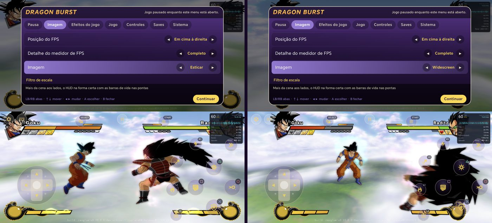
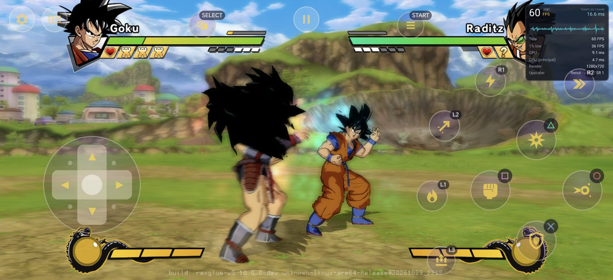
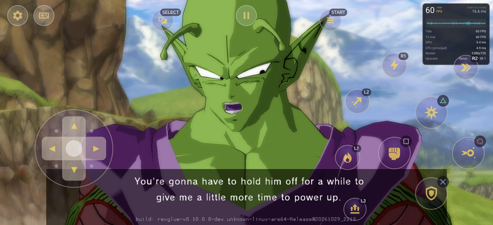
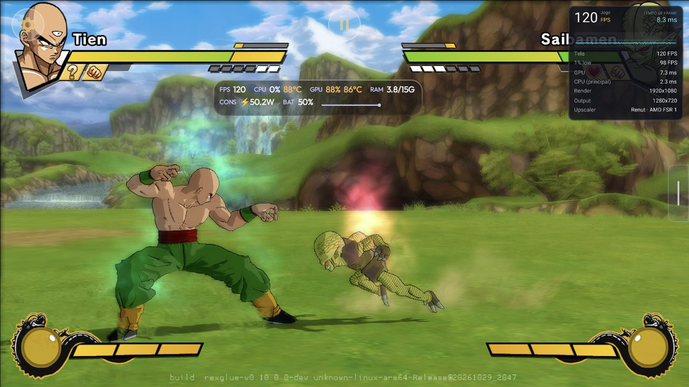
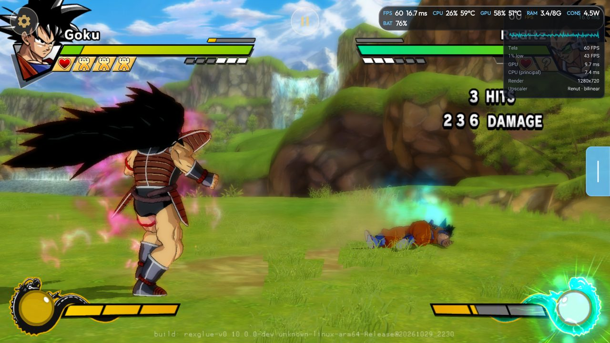
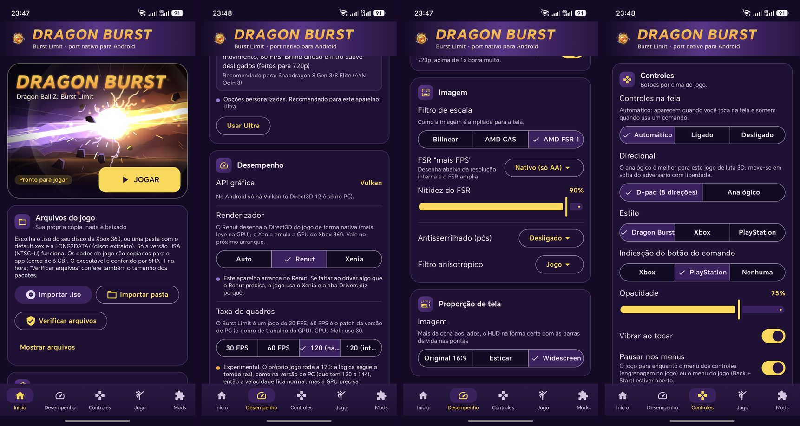
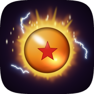

# Changelog

Cada versão em português, inglês e espanhol. O texto de cada release no GitHub (o que o app mostra ao
atualizar) fica em [docs/release/](docs/release/). O histórico de desenvolvimento, com os patches e os
números de cada rodada, fica em [docs/ESTADO.md](docs/ESTADO.md).

Each version in Portuguese, English and Spanish. The GitHub release text (what the app shows when it
updates) is in [docs/release/](docs/release/).

# 0.2.0: Renut · Renut · Renut (2026-10-28)

<table>
  <tr>
    <td colspan="2"></td>
  </tr>
  <tr>
    <td colspan="2">Widescreen ligado ao vivo no menu do jogo · Widescreen switched live in the in-game menu · Panorámico cambiado en vivo en el menú del juego (Honor Magic 7 Pro)</td>
  </tr>
  <tr>
    <td></td>
    <td></td>
  </tr>
  <tr>
    <td></td>
    <td></td>
  </tr>
  <tr>
    <td>AYN Odin 3: Renut 1080p, 120 FPS</td>
    <td>Retroid Pocket 5: Renut 720p, 60 FPS</td>
  </tr>
  <tr>
    <td colspan="2"></td>
  </tr>
  <tr>
    <td colspan="2">Launcher: barra de abas em baixo · bottom tab bar · barra de pestañas abajo;  ícone novo · new icon · icono nuevo</td>
  </tr>
</table>

## PT

Novo renderizador Renut (Direct3D nativo) por padrão, widescreen, 120 FPS no AYN Odin 3 e o RG Cube a 60 FPS.

Renderizador
- Renut, o renderizador nativo do Zandatsu: desenha o Direct3D do jogo direto em Vulkan, sem imitar a GPU do Xbox 360. Desempenho > Renderizador: Auto (padrão), Renut ou Xenia.
- Auto usa sempre o Renut, em todas as GPUs (Adreno com o driver do sistema ou Turnip, Mali); o Xenia fica como opção do jogador.
- Se o jogo fechar, o app avisa e oferece Exportar logs para corrigirmos; a partir do 2.º fecho seguido pergunta se quer usar o Xenia por agora. Nunca troca sozinho.
- O Renut roda com o driver do sistema da Qualcomm (ex.: Retroid Pocket 5), sem precisar do Turnip.
- Imagem do Renut igual à do Xenia: o cabelo e as roupas das personagens com as cores certas (o toon recebia a normal e o UV trocados e ficava cinzento), e as partículas e a tela Now Loading sem quadrados.
- Honor Magic 7 Pro (Adreno 830): o Renut fechava ao arrancar com o driver do sistema; agora abre e joga a 60 FPS. Os drivers da Qualcomm que aceitam menos conjuntos de descritores passam a usar o layout compacto.

Imagem
- Widescreen (telas mais largas que 16:9, com o Renut): o jogo mostra mais da cena aos lados, na forma da tela, e o HUD fica na forma certa, com as barras de vida e os retratos nas pontas. Desempenho > Proporção de tela > Widescreen, ou no menu do jogo (Imagem); liga e desliga a qualquer momento, sem reiniciar.
- Cutscenes, legendas, Drama Pieces, título, Versus e escolha de palco na forma certa em widescreen.
- Proporção de tela passa a ter três escolhas: Original 16:9, Esticar e Widescreen (esta só aparece quando a tela e o renderizador a suportam).

Desempenho
- Nova resolução "Tela": desenha na altura que a imagem ocupa na tela. Nas telas pequenas o app sugere-a no primeiro arranque.
- 1080p com o Renut.
- RG Cube (Mali-G57) com o Renut e "Tela" (360p): 60 FPS na luta e na campanha (antes 22-24 FPS a 720p); 480p 59 FPS; 540p 49-55 FPS.
- Retroid Pocket 5 com o Renut, driver do sistema: 720p a 60 FPS estáveis na luta e na campanha (GPU 8-11 ms por quadro; antes até 60 com quedas para 47-50).
- Perfil 480+ do Retroid Pocket 5 (GPU limitada): 60 FPS a 480p e a 540p, na luta e na campanha. Nos upscales grandes (540p ou 480p numa tela 1080p) o FSR vai até 720p e o resto é bilinear, o que poupa quase metade da GPU por quadro.
- O jogo pausa quando sai da tela (menos bateria e calor): HOME, recentes ou tela desligada param a luta, o desenho e o som, e na volta ele continua de onde estava.
- 120 FPS (nativo) com o Renut: antes ficava nos 60 numa tela de 120 Hz; agora chega aos 120, à mesma velocidade de jogo.
- AYN Odin 3 (Adreno 830) com o Renut, driver do sistema: 1080p a 60 e a 120 FPS na luta e na campanha, 120 estáveis em 15 minutos seguidos.
- 120 FPS (interpolado) testado no Odin 3: 117 na tela com o Renut a 1080p e 120 com o Xenia a 720p.
- Honor Magic 7 Pro, Renut a 720p em widescreen: 60 FPS na luta e na campanha.
- Menos CPU e calor com o Renut: a thread da interface deixou de ocupar um núcleo inteiro (no Odin 3 a CPU desceu de 103 °C para 82 °C de média).

App
- As abas passam para uma barra em baixo, de pé e deitado (deitado, todas cabem de uma vez; de pé a barra rola e mantém a aba escolhida à vista).
- Ícone novo: uma esfera laranja com uma estrela, numa aura dourada com faíscas, com a versão monocromática para os ícones temáticos.

Da versão de PC (v7.3)
- Widescreen (a base do de cima).
- Menos atraso nos comandos: o jogo lê o comando no momento em que pergunta por ele.
- Login com qualquer comando: com o comando no jogador 2-4, o jogo continua a ver o perfil e o Xbox LIVE.
- Conquistas guardadas por perfil.
- Packs de texturas: alfa pré-multiplicado, imagens acima de 8192 reduzidas, mips como os do jogo e cores certas nas texturas ARGB.
- Comandos sem mapeamento no SDL passam a funcionar com um mapeamento genérico.

Arquivos do jogo
- O código do jogo vem cifrado no APK e só se abre com o default.xex do seu disco. Quem atualiza da 0.1.x não precisa importar de novo: no primeiro JOGAR o app prepara o código a partir do jogo já importado (com barra de progresso), e os saves e as opções ficam.

Resolvido da 0.1.x
- Já há 1080p (com o Renut).
- RG Cube: 60 FPS com "Tela" e 49-55 FPS a 540p com o Renut (o objetivo era 540p a 30).
- 120 FPS testados num aparelho de 120 Hz (AYN Odin 3).

Problemas conhecidos
- Só a versão USA (NTSC-U) do jogo.
- Widescreen só com o Renut; com o Xenia a imagem fica em 16:9 (o HUD não é reposicionado no Vulkan).
- Em widescreen o Renut desenha 1280 colunas e estica-as até à largura da tela: a imagem fica um pouco mais suave na horizontal.
- Em widescreen o menu principal fica com faixas escuras aos lados (como na versão de PC).
- AYN Odin 3: os números são de antes da correção do Honor Magic 7 Pro (layout de descritores da Qualcomm); falta medir de novo.
- Turnip no Adreno 650 (Retroid Pocket 5) deixa a imagem errada: use o driver do sistema.
- Xenia: na tela de título o Start pode precisar de vários toques.
- Xenia acima de 720p (2K, 4K): o render nativo desliga.
- 120 FPS experimentais: o online não foi verificado a 120.
- Online só por rede local, experimental e não testado entre dois aparelhos; sem lobby pela internet nem cross-play com o PC.
- Packs de texturas e mods grandes ainda não testados nos aparelhos.

## EN

New Renut renderer (native Direct3D) by default, widescreen, 120 FPS on the AYN Odin 3 and the RG Cube at 60 FPS.

Renderer
- Renut, the Zandatsu native renderer: it draws the game's Direct3D straight to Vulkan instead of emulating the Xbox 360 GPU. Performance > Renderer: Auto (default), Renut or Xenia.
- Auto always uses the Renut, on every GPU (Adreno on the system driver or Turnip, Mali); Xenia stays as the player's option.
- If the game closes, the app says so and offers Export logs so we can fix it; from the 2nd close in a row it asks whether to use Xenia for now. It never switches by itself.
- The Renut runs on Qualcomm's system driver (e.g. Retroid Pocket 5), no Turnip needed.
- The Renut's picture matches Xenia's: the characters' hair and clothes in the right colours (the toon shader got the normal and the UV swapped and turned grey), and particles and the Now Loading screen without squares.
- Honor Magic 7 Pro (Adreno 830): the Renut closed at start on the system driver; it now starts and plays at 60 FPS. Qualcomm drivers that accept fewer descriptor sets now use the compact layout.

Image
- Widescreen (screens wider than 16:9, with the Renut): the game shows more of the scene at the sides, in the screen's shape, and the HUD keeps its shape, with the life bars and portraits at the edges. Performance > Aspect ratio > Widescreen, or in the in-game menu (Image); turn it on and off at any time, no restart.
- Cutscenes, subtitles, Drama Pieces, title, Versus and stage select in shape in widescreen.
- Aspect ratio now has three choices: Original 16:9, Stretch to fill and Widescreen (shown only when the screen and the renderer support it).

Performance
- New "Screen" resolution: draws at the height the picture takes on the screen. On small screens the app suggests it at first launch.
- 1080p with the Renut.
- RG Cube (Mali-G57) with the Renut and "Screen" (360p): 60 FPS in fights and in the campaign (was 22-24 FPS at 720p); 480p 59 FPS; 540p 49-55 FPS.
- Retroid Pocket 5 with the Renut, system driver: a steady 60 FPS at 720p in fights and in the campaign (8-11 ms of GPU a frame; was up to 60 with drops to 47-50).
- Retroid Pocket 5 480+ profile (GPU limited): 60 FPS at 480p and at 540p, in fights and in the campaign. On large upscales (540p or 480p on a 1080p screen) FSR goes up to 720p and the rest is bilinear, which saves almost half of the GPU time a frame.
- The game pauses when it leaves the screen (less battery and heat): Home, recents or the screen going off stop the fight, the drawing and the sound, and it carries on from where it was when you come back.
- 120 FPS (native) with the Renut: it stayed at 60 on a 120 Hz screen; it now reaches 120, at the same game speed.
- AYN Odin 3 (Adreno 830) with the Renut, system driver: 1080p at 60 and at 120 FPS in fights and in the campaign, a steady 120 over 15 minutes in a row.
- 120 FPS (interpolated) tested on the Odin 3: 117 on screen with the Renut at 1080p and 120 with Xenia at 720p.
- Honor Magic 7 Pro, Renut at 720p in widescreen: 60 FPS in fights and in the campaign.
- Less CPU and heat with the Renut: the interface thread no longer takes a whole core (on the Odin 3 the CPU went from 103 °C to 82 °C on average).

App
- The tabs move to a bar at the bottom, in portrait and landscape (in landscape they all fit at once; in portrait the bar scrolls and keeps the chosen tab in view).
- New icon: an orange orb with a star, in a golden aura with sparks, with the monochrome version for themed icons.

From the PC version (v7.3)
- Widescreen (the base of the one above).
- Less input delay: the game reads the controller at the moment it asks for it.
- Sign-in with any controller: with the pad on player 2-4 the game still sees the profile and Xbox LIVE.
- Achievements kept per profile.
- Texture packs: premultiplied alpha, images over 8192 downscaled, mips like the game's and the right colours on ARGB textures.
- Controllers SDL has no mapping for now work with a generic one.

Game files
- The game code ships encrypted in the APK and only opens with your disc's default.xex. Updating from 0.1.x needs no new import: on the first PLAY the app prepares the code from the game you already imported (with a progress bar), and your saves and options stay.

Fixed since 0.1.x
- There is now 1080p (with the Renut).
- RG Cube: 60 FPS with "Screen" and 49-55 FPS at 540p with the Renut (the goal was 540p at 30).
- 120 FPS tested on a 120 Hz device (AYN Odin 3).

Known issues
- USA (NTSC-U) version of the game only.
- Widescreen only with the Renut; with Xenia the picture stays 16:9 (the HUD is not repositioned on Vulkan).
- In widescreen the Renut draws 1280 columns and stretches them to the screen width: the picture is a little softer horizontally.
- In widescreen the main menu keeps dark bars at the sides (as in the PC version).
- AYN Odin 3: the numbers are from before the Honor Magic 7 Pro fix (Qualcomm descriptor layout); they still need measuring again.
- Turnip on the Adreno 650 (Retroid Pocket 5) gives a wrong image: use the system driver.
- Xenia: on the title screen Start may need several presses.
- Xenia above 720p (2K, 4K): the native render turns off.
- 120 FPS is experimental: online has not been checked at 120.
- Online is local network only, experimental and not tested between two devices; no internet lobby or cross-play with PC.
- Large texture packs and mods not yet tested on the devices.

## ES

Nuevo renderizador Renut (Direct3D nativo) por defecto, panorámico, 120 FPS en la AYN Odin 3 y la RG Cube a 60 FPS.

Renderizador
- Renut, el renderizador nativo de Zandatsu: dibuja el Direct3D del juego directamente en Vulkan, sin emular la GPU de Xbox 360. Rendimiento > Renderizador: Auto (por defecto), Renut o Xenia.
- Auto usa siempre el Renut, en todas las GPU (Adreno con el driver del sistema o Turnip, Mali); Xenia queda como opción del jugador.
- Si el juego se cierra, la app lo avisa y ofrece Exportar logs para que lo corrijamos; a partir del 2.º cierre seguido pregunta si quieres usar Xenia por ahora. Nunca cambia solo.
- El Renut funciona con el driver del sistema de Qualcomm (p. ej. Retroid Pocket 5), sin Turnip.
- Imagen del Renut igual a la de Xenia: el pelo y la ropa de los personajes con los colores correctos (el toon recibía la normal y el UV cambiados y quedaba gris), y las partículas y la pantalla Now Loading sin cuadrados.
- Honor Magic 7 Pro (Adreno 830): el Renut se cerraba al arrancar con el driver del sistema; ahora abre y juega a 60 FPS. Los drivers de Qualcomm que aceptan menos conjuntos de descriptores usan ahora el layout compacto.

Imagen
- Panorámico (pantallas más anchas que 16:9, con el Renut): el juego muestra más de la escena a los lados, con la forma de la pantalla, y el HUD mantiene su forma, con las barras de vida y los retratos en los extremos. Rendimiento > Relación de aspecto > Panorámico, o en el menú del juego (Imagen); se activa y desactiva en cualquier momento, sin reiniciar.
- Cinemáticas, subtítulos, Drama Pieces, título, Versus y elección de escenario en su forma en panorámico.
- Relación de aspecto pasa a tener tres opciones: Original 16:9, Estirar para llenar y Panorámico (esta solo aparece cuando la pantalla y el renderizador lo admiten).

Rendimiento
- Nueva resolución "Pantalla": dibuja a la altura que ocupa la imagen en la pantalla. En pantallas pequeñas la app la sugiere en el primer arranque.
- 1080p con el Renut.
- RG Cube (Mali-G57) con el Renut y "Pantalla" (360p): 60 FPS en combate y en la campaña (antes 22-24 FPS a 720p); 480p 59 FPS; 540p 49-55 FPS.
- Retroid Pocket 5 con el Renut, driver del sistema: 720p a 60 FPS estables en combate y en la campaña (8-11 ms de GPU por cuadro; antes hasta 60 con caídas a 47-50).
- Perfil 480+ de la Retroid Pocket 5 (GPU limitada): 60 FPS a 480p y a 540p, en combate y en la campaña. En los escalados grandes (540p o 480p en una pantalla 1080p) el FSR llega hasta 720p y el resto es bilineal, lo que ahorra casi la mitad de la GPU por cuadro.
- El juego se pausa cuando sale de la pantalla (menos batería y calor): Inicio, recientes o la pantalla apagada detienen el combate, el dibujo y el sonido, y al volver sigue donde estaba.
- 120 FPS (nativo) con el Renut: antes se quedaba en 60 en una pantalla de 120 Hz; ahora llega a 120, a la misma velocidad de juego.
- AYN Odin 3 (Adreno 830) con el Renut, driver del sistema: 1080p a 60 y a 120 FPS en combate y en la campaña, 120 estables durante 15 minutos seguidos.
- 120 FPS (interpolado) probado en la Odin 3: 117 en pantalla con el Renut a 1080p y 120 con Xenia a 720p.
- Honor Magic 7 Pro, Renut a 720p en panorámico: 60 FPS en combate y en la campaña.
- Menos CPU y calor con el Renut: el hilo de la interfaz ya no ocupa un núcleo entero (en la Odin 3 la CPU bajó de 103 °C a 82 °C de media).

Aplicación
- Las pestañas pasan a una barra abajo, en vertical y en horizontal (en horizontal caben todas a la vez; en vertical la barra se desplaza y mantiene a la vista la pestaña elegida).
- Icono nuevo: una esfera naranja con una estrella, en un aura dorada con chispas, con la versión monocromática para los iconos temáticos.

De la versión de PC (v7.3)
- Panorámico (la base del de arriba).
- Menos retraso en los controles: el juego lee el mando en el momento en que lo pide.
- Inicio de sesión con cualquier mando: con el mando en el jugador 2-4 el juego sigue viendo el perfil y Xbox LIVE.
- Logros guardados por perfil.
- Packs de texturas: alfa premultiplicado, imágenes de más de 8192 reducidas, mips como los del juego y colores correctos en las texturas ARGB.
- Los mandos sin mapeo en SDL funcionan ahora con uno genérico.

Archivos del juego
- El código del juego va cifrado en el APK y solo se abre con el default.xex de tu disco. Al actualizar desde la 0.1.x no hace falta importar de nuevo: en el primer JUGAR la app prepara el código a partir del juego ya importado (con barra de progreso), y las partidas guardadas y las opciones se mantienen.

Resuelto desde la 0.1.x
- Ya hay 1080p (con el Renut).
- RG Cube: 60 FPS con "Pantalla" y 49-55 FPS a 540p con el Renut (el objetivo era 540p a 30).
- 120 FPS probados en un dispositivo de 120 Hz (AYN Odin 3).

Problemas conocidos
- Solo la versión USA (NTSC-U) del juego.
- Panorámico solo con el Renut; con Xenia la imagen queda en 16:9 (el HUD no se recoloca en Vulkan).
- En panorámico el Renut dibuja 1280 columnas y las estira al ancho de la pantalla: la imagen queda un poco más suave en horizontal.
- En panorámico el menú principal queda con franjas oscuras a los lados (como en la versión de PC).
- AYN Odin 3: los números son de antes de la corrección del Honor Magic 7 Pro (layout de descriptores de Qualcomm); falta medirlos de nuevo.
- Turnip en la Adreno 650 (Retroid Pocket 5) da una imagen incorrecta: usa el driver del sistema.
- Xenia: en la pantalla de título Start puede necesitar varias pulsaciones.
- Xenia por encima de 720p (2K, 4K): el render nativo se desactiva.
- 120 FPS experimentales: el online no se comprobó a 120.
- Online solo por red local, experimental y sin probar entre dos dispositivos; sin lobby por internet ni juego cruzado con PC.
- Packs de texturas y mods grandes aún sin probar en los dispositivos.

# 0.1.2: Mali e kernel 4.14 · Mali and kernel 4.14 · Mali y kernel 4.14 (2026-10-17)

## PT

Mais desempenho nos celulares com Mali e correção para aparelhos com kernel antigo.

Desempenho
- Mali e outros chips fora da Adreno (ex.: Galaxy M54, RG Cube): três otimizações novas ligadas por padrão (cópia direta para a textura, resolves servidos pelo passo 4, escritas sem leitor). No Galaxy M54 a 540p a GPU caiu de ~36-40 ms para ~29-33 ms por quadro.

Correções
- POCO X3 Pro e outros aparelhos com kernel Linux 4.14 (ex.: Snapdragon 855/860): o jogo travava no começo, antes do menu. A reserva de memória do jogo foi corrigida para esses kernels.
- Se a memória do jogo falhar, o app mostra uma mensagem e fecha em vez de travar.

Diagnóstico
- O log mostra a RAM, o kernel e o resultado da reserva de memória do jogo.

## EN

More performance on Mali phones and a fix for devices with an old kernel.

Performance
- Mali and other non-Adreno chips (e.g. Galaxy M54, RG Cube): three new optimizations on by default (direct copy to the texture, resolves served by step 4, unread writes). On the Galaxy M54 at 540p the GPU went from ~36-40 ms to ~29-33 ms per frame.

Fixes
- POCO X3 Pro and other devices with Linux kernel 4.14 (e.g. Snapdragon 855/860): the game froze at startup, before the menu. The game's memory reservation now works on these kernels.
- If the game's memory fails, the app shows a message and closes instead of freezing.

Diagnostics
- The log shows the RAM, the kernel and the result of the game's memory reservation.

## ES

Más rendimiento en los móviles con Mali y corrección para dispositivos con kernel antiguo.

Rendimiento
- Mali y otros chips que no son Adreno (p. ej. Galaxy M54, RG Cube): tres optimizaciones nuevas activadas por defecto (copia directa a la textura, resolves servidos por el paso 4, escrituras sin lector). En el Galaxy M54 a 540p la GPU bajó de ~36-40 ms a ~29-33 ms por cuadro.

Correcciones
- POCO X3 Pro y otros dispositivos con kernel Linux 4.14 (p. ej. Snapdragon 855/860): el juego se colgaba al inicio, antes del menú. La reserva de memoria del juego ya funciona en esos kernels.
- Si la memoria del juego falla, la app muestra un mensaje y se cierra en vez de colgarse.

Diagnóstico
- El log muestra la RAM, el kernel y el resultado de la reserva de memoria del juego.

# 0.1.1: correções · fixes · correcciones (2026-10-17)

## PT

Correções da imagem e base para mais desempenho nos celulares com Mali.

Correções
- Galaxy S20 FE e outros Snapdragon 865 com o driver da Samsung: a luta podia aparecer com um degradê azul e laranja por cima. A composição do brilho por compute ficou desligada.
- Mali (ex.: Galaxy M54, RG Cube) a 540p: a imagem podia aparecer espremida numa faixa no topo da tela. A imagem final direta não liga mais abaixo de 720p.

Desempenho (em teste)
- Três otimizações novas para Mali, desligadas por padrão: cópia direta para a textura sem buffer, resolves servidos pelo passo 4 e escritas sem leitor. O autoteste do render testa cada uma; mande o zip do Exportar logs para ajudar a ligá-las na próxima versão.

Diagnóstico
- O log mostra por que cada passe do passo 4 é bloqueado e quem lê cada resolve.

## EN

Image fixes and groundwork for more performance on Mali phones.

Fixes
- Galaxy S20 FE and other Snapdragon 865 phones with Samsung's driver: the fight could show a blue and orange gradient on top. The compute glow composite is now off.
- Mali (e.g. Galaxy M54, RG Cube) at 540p: the image could be squashed into a strip at the top of the screen. The direct final image no longer runs below 720p.

Performance (testing)
- Three new Mali optimizations, off by default: direct copy to the texture without a buffer, resolves served by step 4, and unread writes. The render self-test checks each one; send the Export logs zip to help turn them on in the next version.

Diagnostics
- The log shows why each step 4 pass is blocked and who reads each resolve.

## ES

Correcciones de imagen y base para más rendimiento en los móviles con Mali.

Correcciones
- Galaxy S20 FE y otros Snapdragon 865 con el driver de Samsung: la pelea podía verse con un degradado azul y naranja encima. La composición del brillo por compute queda desactivada.
- Mali (p. ej. Galaxy M54, RG Cube) a 540p: la imagen podía verse aplastada en una franja arriba de la pantalla. La imagen final directa ya no se usa por debajo de 720p.

Rendimiento (en prueba)
- Tres optimizaciones nuevas para Mali, desactivadas por defecto: copia directa a la textura sin búfer, resolves servidos por el paso 4 y escrituras sin lector. La autoprueba del render prueba cada una; envía el zip de Exportar logs para ayudar a activarlas en la próxima versión.

Diagnóstico
- El log muestra por qué se bloquea cada pase del paso 4 y quién lee cada resolve.

# 0.1.0: primeira versão · first release · primera versión (2026-10-17)

## PT

Primeira versão pública. Dragon Ball Z: Burst Limit (Xbox 360) rodando nativo no Android, sem emulação,
a partir do DBZ Burst Limit Recompiled v5.2. Nenhum arquivo do jogo vem incluído: você importa a sua
própria cópia USA (NTSC-U).

### O que o app faz
- Importa o jogo do `.iso` ou de uma pasta extraída, só a versão USA, e avisa se o disco é de outro jogo,
  de outra região, alterado ou cortado. **Verificar arquivos** confere a instalação.
- Todas as opções da versão de PC que funcionam no Android: roupas do modo história, cenários extras,
  começar transformado, carregar ki (L3), personagens extras de mods, ícones de botão, campo de visão,
  câmera livre e modo foto.
- Mods e packs de texturas HD no formato da versão de PC, extração de texturas para criar packs.
- Saves: exportar/importar, o mesmo `.zip` da versão de PC e do Xenia.
- Menu do jogo próprio do Android (Back + Start), launcher em português, inglês e espanhol.
- Atualizações pelo próprio app, com o resumo do que mudou.
- Autoteste do render e **Exportar logs** para reportar problemas.

### Desempenho
- Render nativo em 4 passos (imagem final direta, profundidade linear por compute, pós-processamento
  enxuto com contorno, redução, desfoque e brilho por compute, passes direto na textura), mais as
  otimizações de GPU do Dragon Fury. A 540p os mesmos passos ligam (patch 0091,
  ainda não confirmado no aparelho).
- Retroid Pocket 5 (Snapdragon 865): 720p com todos os efeitos a até 60 FPS (cerca de 47-50 FPS nas
  cenas pesadas). RG Cube (Mali-G57): 22-24 FPS a 720p com efeitos.

### Opções gráficas
- 5 predefinições (Mínimo, Leve, Equilibrado, Alto, Ultra) com os processadores recomendados; o app
  sugere a do seu aparelho.
- Resolução interna de 480p, 540p, 720p, 2K ou 4K.
- Efeitos do jogo ligáveis (profundidade de campo, brilho, desfoque de movimento, filtro suave), AMD
  FSR 1 + CAS, FXAA, anisotrópico.
- Drivers Turnip (Mesa) baixados pelo app, com o nível de suporte por Snapdragon. Experimental.

### 120 FPS
- Em telas de 120 Hz: **120 (interpolado)**, o jogo a 60 com um quadro gerado entre cada dois, e
  **120 (nativo)**, o jogo inteiro a 120. Os dois são experimentais: ainda não testados num aparelho de
  120 Hz.

### Controles
- Controles na tela com D-pad de 8 direções (ou analógico), visual do jogo e transparência; aparecem ao
  tocar e somem com um controle físico.
- Layouts de luta, menus e câmera livre, editor de layout e macros. Controles físicos com zona morta e
  vibração.

### Online
- Rede local (Wi-Fi), o método LAN da versão de PC. Experimental: ainda não testado entre dois
  aparelhos.

### Limitações conhecidas
- Só a versão USA do jogo.
- Lobby pela internet (Ranked, placares) ainda não disponível; sem cross-play com o PC.
- Mali-G57 MC4 (ex.: RG Cube): 540p a 30 FPS é o objetivo; a correção (patch 0091) ainda não foi
  confirmada no aparelho. A 480p só parte do render nativo liga.
- Turnip no Adreno 650 (Retroid Pocket 5) deixa a imagem errada: use o driver do sistema.
- Acima de 720p (2K, 4K) o render nativo desliga. Não há 1080p.
- Packs de texturas e mods ainda não foram testados com packs grandes nos aparelhos.

## EN

First public release. Dragon Ball Z: Burst Limit (Xbox 360) running natively on Android, not emulated,
built from DBZ Burst Limit Recompiled v5.2. No game files are included: you import your own USA (NTSC-U)
copy.

### What the app does
- Imports the game from the `.iso` or an extracted folder, USA version only, and tells you if the disc
  is another game, another region, modified or truncated. **Verify files** checks the install.
- Every PC version option that works on Android: story mode costumes, extra stages, start transformed,
  ki charge (L3), extra characters from mods, button icons, field of view, free camera and photo mode.
- PC-format mods and HD texture packs, texture dumping to make packs.
- Saves: export/import, the same `.zip` as the PC version and Xenia.
- Android in-game menu (Back + Start), launcher in Portuguese, English and Spanish.
- Updates through the app itself, with a summary of what changed.
- Render self-test and **Export logs** to report problems.

### Performance
- A 4-step native renderer (final image presented directly, linear depth by compute, lean
  post-processing with outline, downsample, blur and glow by compute, passes drawn straight into their
  textures), plus the Dragon Fury GPU optimizations. At 540p the same steps turn on (patch
  0091, not yet confirmed on a device).
- Retroid Pocket 5 (Snapdragon 865): 720p with every effect at up to 60 FPS (about 47-50 FPS in heavy
  scenes). RG Cube (Mali-G57): 22-24 FPS at 720p with effects.

### Graphics options
- 5 presets (Minimum, Light, Balanced, High, Ultra) with recommended processors; the app suggests the
  one for your device.
- Internal resolution 480p, 540p, 720p, 2K or 4K.
- Game effect toggles (depth of field, glow, motion blur, soft filter), AMD FSR 1 + CAS, FXAA,
  anisotropic.
- Turnip (Mesa) drivers downloaded by the app, with the support level per Snapdragon. Experimental.

### 120 FPS
- On 120 Hz screens: **120 (interpolated)**, the game at 60 with a generated frame between each two, and
  **120 (native)**, the whole game at 120. Both are experimental: not yet tested on a 120 Hz device.

### Controls
- Touch controls with an 8-way D-pad (or analog stick), the game's look and transparency; shown when you
  touch, hidden when you use a physical controller.
- Fight, menu and free camera layouts, layout editor and macros. Physical controllers with deadzone and
  vibration.

### Online
- Local network (Wi-Fi), the PC version's LAN method. Experimental: not yet tested between two devices.

### Known limitations
- USA version of the game only.
- Internet lobby (Ranked, leaderboards) not available yet; no cross-play with PC.
- Mali-G57 MC4 (e.g. RG Cube): 540p at 30 FPS is the goal; the fix (patch 0091) is not yet confirmed on
  the device. At 480p only part of the native renderer runs.
- Turnip on the Adreno 650 (Retroid Pocket 5) gives a wrong image: use the system driver.
- Above 720p (2K, 4K) the native renderer turns off. There is no 1080p.
- Texture packs and mods have not been tested with large packs on the devices yet.

## ES

Primera versión pública. Dragon Ball Z: Burst Limit (Xbox 360) ejecutándose de forma nativa en Android,
sin emulación, a partir de DBZ Burst Limit Recompiled v5.2. No incluye archivos del juego: importas tu
propia copia USA (NTSC-U).

### Qué hace la app
- Importa el juego del `.iso` o de una carpeta extraída, solo la versión USA, y avisa si el disco es de
  otro juego, de otra región, está modificado o cortado. **Verificar archivos** comprueba la instalación.
- Todas las opciones de la versión de PC que funcionan en Android: trajes del modo historia, escenarios
  extra, empezar transformado, cargar ki (L3), personajes extra de mods, iconos de botones, campo de
  visión, cámara libre y modo foto.
- Mods y packs de texturas HD en el formato de PC, extracción de texturas para crear packs.
- Partidas: exportar/importar, el mismo `.zip` que la versión de PC y Xenia.
- Menú del juego propio de Android (Back + Start), launcher en portugués, inglés y español.
- Actualizaciones desde la propia app, con un resumen de lo que cambió.
- Autotest del render y **Exportar logs** para reportar problemas.

### Rendimiento
- Un render nativo en 4 pasos (imagen final directa, profundidad lineal por compute, posprocesado ligero
  con contorno, reducción, desenfoque y brillo por compute, pases dibujados directamente en sus
  texturas), más las optimizaciones de GPU de Dragon Fury. A 540p se activan los mismos pasos (parche
  0091, aún sin confirmar en un dispositivo).
- Retroid Pocket 5 (Snapdragon 865): 720p con todos los efectos a hasta 60 FPS (unos 47-50 FPS en las
  escenas pesadas). RG Cube (Mali-G57): 22-24 FPS a 720p con efectos.

### Opciones gráficas
- 5 preajustes (Mínimo, Ligero, Equilibrado, Alto, Ultra) con los procesadores recomendados; la app
  sugiere el de tu dispositivo.
- Resolución interna de 480p, 540p, 720p, 2K o 4K.
- Efectos del juego activables (profundidad de campo, brillo, desenfoque de movimiento, filtro suave),
  AMD FSR 1 + CAS, FXAA, anisotrópico.
- Drivers Turnip (Mesa) descargados desde la app, con el nivel de soporte por Snapdragon. Experimental.

### 120 FPS
- En pantallas de 120 Hz: **120 (interpolado)**, el juego a 60 con un fotograma generado entre cada dos,
  y **120 (nativo)**, todo el juego a 120. Los dos son experimentales: aún sin probar en un dispositivo
  de 120 Hz.

### Controles
- Controles táctiles con cruceta de 8 direcciones (o stick analógico), el estilo del juego y
  transparencia; aparecen al tocar y se ocultan con un mando físico.
- Diseños de combate, menús y cámara libre, editor de diseño y macros. Mandos físicos con zona muerta y
  vibración.

### Online
- Red local (Wi-Fi), el método LAN de la versión de PC. Experimental: aún sin probar entre dos
  dispositivos.

### Limitaciones conocidas
- Solo la versión USA del juego.
- Lobby por internet (Ranked, clasificaciones) aún no disponible; sin juego cruzado con PC.
- Mali-G57 MC4 (p. ej. RG Cube): 540p a 30 FPS es el objetivo; la corrección (parche 0091) aún no está
  confirmada en el dispositivo. A 480p solo funciona parte del render nativo.
- Turnip en la Adreno 650 (Retroid Pocket 5) da una imagen incorrecta: usa el driver del sistema.
- Por encima de 720p (2K, 4K) el render nativo se desactiva. No hay 1080p.
- Los packs de texturas y los mods aún no se probaron con packs grandes en los dispositivos.
