<p align="center"></p>

# 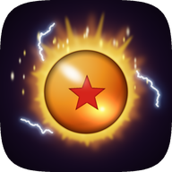 Dragon Burst

[Português](README.md) · **English** · [Español](README.es.md)

Native Android port of **[DBZ Burst Limit Recompiled](https://github.com/iExplosiveRage/DBZ-Burst-Limit-Recompiled)**
(iExplosiveRage), the static recompilation of the Xbox 360 Dragon Ball Z: Burst Limit. The game code runs
natively on arm64 (it is not emulated), on top of the ReXGlue SDK runtime on Vulkan and the Dragon Fury
base (the Android port of DBZ Budokai 3 HD). The picture comes from the **Renut**, a native renderer that
draws the game's Direct3D straight to Vulkan.

> **No game files are included.** You need your own legal copy, **USA (NTSC-U)** version.
>
> **Version 0.2.0.** Tested on the Retroid Pocket 5, the Anbernic RG Cube, the AYN Odin 3 and the Honor
> Magic 7 Pro. Anything not yet tested on a device is marked **experimental**. Everything that changed,
> version by version: [CHANGELOG.md](CHANGELOG.md).

<p align="center">
  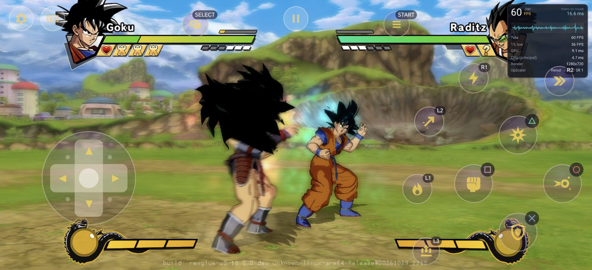<br>
  <sub>Honor Magic 7 Pro (2800x1280, 2.19:1), Renut at 720p in widescreen: 60 FPS in fights.</sub>
</p>

## What's new in 0.2.0

- The **Renut** native renderer by default on every GPU (Adreno on the system driver or Turnip, Mali).
  Xenia stays as an option.
- **Widescreen** on screens wider than 16:9: more of the scene at the sides and the HUD in shape. Turn it
  on and off at any time, no restart.
- **60 FPS** on the Retroid Pocket 5 at 720p and on the RG Cube with the "Screen" resolution; **120 FPS**
  on the AYN Odin 3 at 1080p, steady over 15 minutes in a row.
- The game **pauses when it leaves the screen** (less battery and heat) and uses less CPU.
- The launcher has the **tab bar at the bottom** and a **new icon**.
- The fixes from the **PC version v7.3** (less input delay, sign-in with any controller, achievements per
  profile, texture packs).

## Widescreen

On screens wider than 16:9 (most phones), with the Renut, the **Widescreen** option shows more of the
scene at the sides, in the screen's shape, without stretching the characters. The HUD keeps its shape: the
life bars and portraits go to the edges, the timer stays in the middle, and subtitles and Drama Pieces are
not distorted. It is the widescreen from the PC version v7.3, with the GPU side made for the Renut.

- **Where:** Performance → Aspect ratio → **Original 16:9 / Stretch to fill / Widescreen**, or in the
  in-game menu (Back + Start) → Image. The option only shows when the screen is wider than 16:9 and the
  renderer is the Renut.
- **On and off live:** in the in-game menu the change applies on the next frame, in the middle of a fight
  or a cutscene.

<p align="center">
  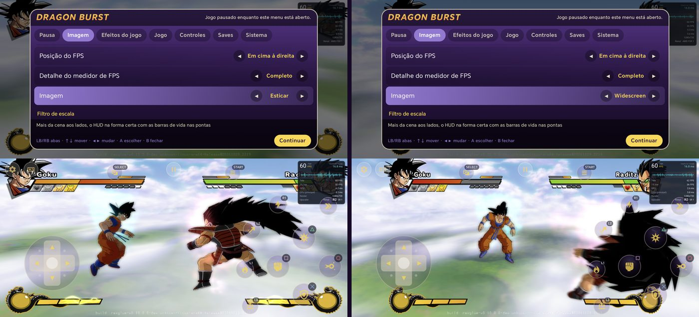<br>
  <sub>The same moment, switched in the in-game menu: Stretch (left, characters widened) and Widescreen
  (right, more of the scene and the right proportions).</sub>
</p>

<table>
  <tr>
    <td>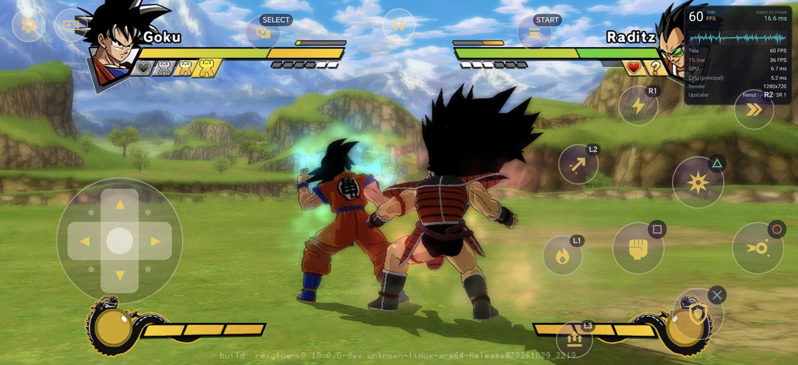</td>
    <td>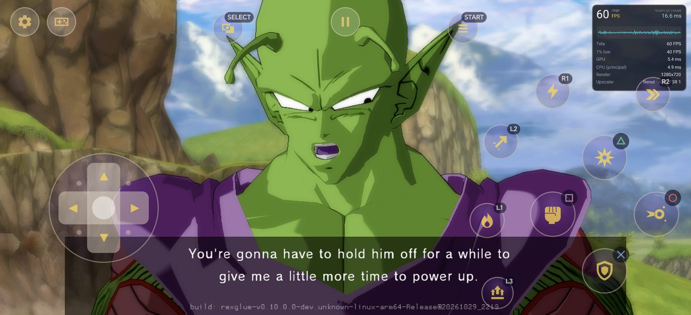</td>
  </tr>
  <tr>
    <td><sub>Campaign (Z Chronicles): 60 FPS, minimum 59.7.</sub></td>
    <td><sub>Full-screen cutscenes, subtitles in shape.</sub></td>
  </tr>
</table>

<p align="center">
  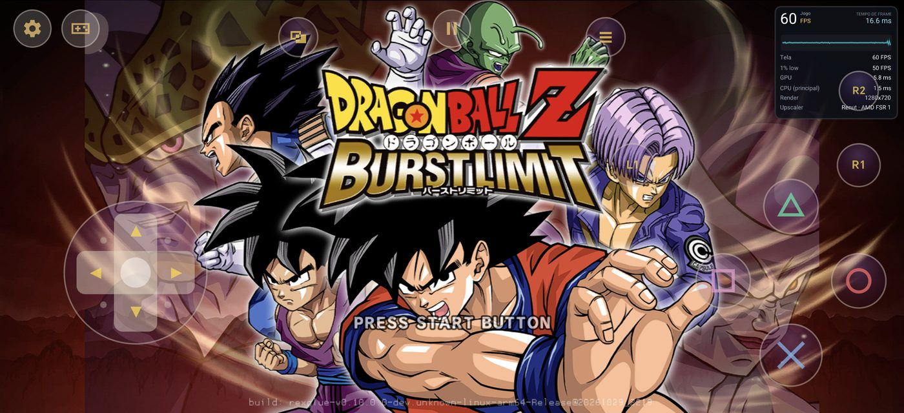<br>
  <sub>Title screen: the background reaches the edges, characters and text undistorted.</sub>
</p>

## Launcher

<p align="center">
  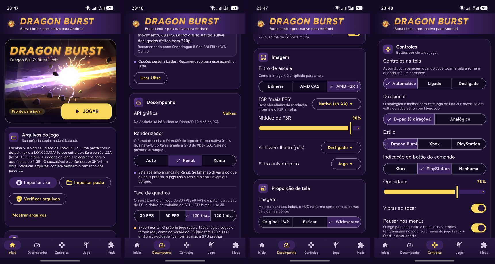<br>
  <sub>Home, Performance (renderer and frame rate), Aspect ratio and Controls (the app in Portuguese).</sub>
</p>

<p align="center">
  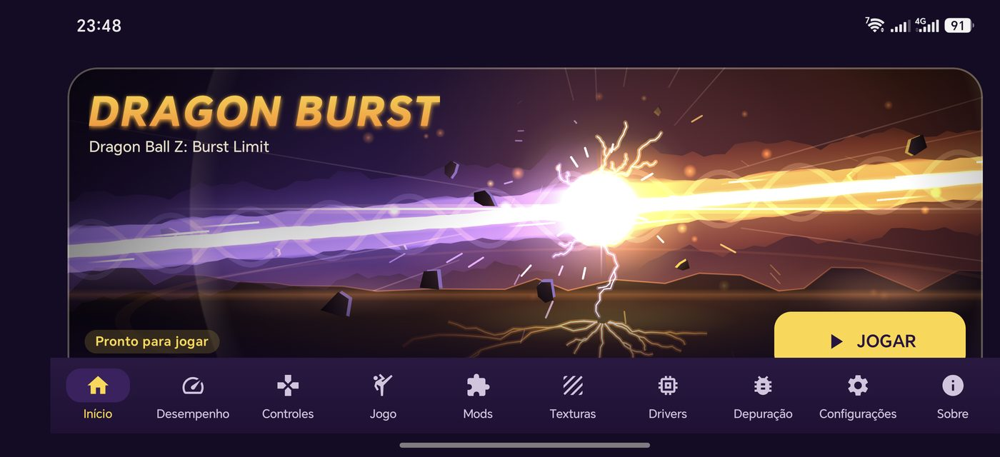<br>
  <sub>In landscape all ten tabs fit at once in the bottom bar.</sub>
</p>

- Import the game straight from the `.iso` or from an extracted folder (`default.xex` + `LONG2DATA/`). USA
  version only: the app checks the executable and tells you if the disc is another game, another region,
  modified or truncated. **Verify files** checks the install later.
- The game code ships encrypted in the APK and only opens with your disc's `default.xex`. On the first
  PLAY the app prepares it from the imported game (with a progress bar); coming from 0.1.x needs no new
  import.
- **Tab bar at the bottom**, in portrait and landscape: Home, Performance, Controls, Game, Mods, Textures,
  Drivers, Debug, Settings and About. In portrait the bar scrolls and keeps the chosen tab in view.
- **New icon**: an orange orb with a star, in a golden aura with sparks (an original drawing). It also has
  the monochrome version for Android 13+ themed icons.
- Its own theme, Portuguese, English and Spanish, a home screen shortcut.
- **Automatic updates**: when it opens, the app looks for a new version in the GitHub Releases, shows what
  changed (in the app's language), downloads the APK and opens the installer.

## Features

**Game** (the PC version options that work on Android)
- 30 FPS (original) or 60 FPS, and the 120 FPS modes (below).
- Story mode costumes, extra stages, start transformed (RB/LB), ki charge (hold L3), extra characters
  from mods, Xbox/PlayStation/Switch button icons, "Online" instead of "Xbox LIVE", menu sounds, field of
  view, free camera and freeze the game (photo mode).
- An Android in-game menu (Back + Start, or the pause button): image, effects, game, controls, save and
  system, with the game paused.
- **Pause off screen**: Home, recents or the screen going off stop the fight, the drawing and the sound;
  when you come back the game carries on from where it was.
- **Saves**: export/import from the in-game menu; the same `.zip` as the PC version and Xenia. The Game
  tab copies saves to and from the Download folder. Achievements kept per profile.

**Mods and textures**
- PC-format mods (`mods/`, `mod.toml`): install `.zip`, turn on/off, type detected, warnings for conflicts
  and an extra folder level.
- **HD texture packs** (texture replacement was ported to Vulkan): several packs, one active, name and
  format checks, optional preloading and dumping the original textures to make packs. As in PC v7.3:
  premultiplied alpha, images over 8192 downscaled, mips like the game's and the right colours on ARGB
  textures.

**Graphics**
- **Renderer**: Auto (default, always uses the Renut), Renut or Xenia.
- **5 presets** (Minimum, Light, Balanced, High, Ultra) with the recommended processors for each; the app
  suggests the one for your device.
- Internal resolution **Screen, 480p, 540p, 720p, 1080p (Renut only), 2K (1440p) or 4K (2160p)**.
  "Screen" draws at the height the picture takes on the screen; on small screens the app suggests it at
  first launch.
- **Aspect ratio**: Original 16:9, Stretch to fill or **Widescreen** (above).
- Game effect toggles (depth of field, glow, motion blur, soft filter), AMD FSR 1 + CAS, FXAA, anisotropic
  filtering. On large upscales (540p or 480p on a 1080p screen) FSR goes up to 720p and the rest is
  bilinear, which saves almost half of the GPU time a frame.
- **Vulkan drivers**: the system one or Turnip (Mesa) through libadrenotools, downloaded from the
  community repositories or imported. The Drivers tab shows Turnip's support level for your Snapdragon.
  **Turnip is experimental in this port** (see the tested devices).

**120 FPS** (only on 120 Hz screens; on others the options are hidden)
- **120 (native)**: the game itself runs at 120, as in the PC version, at the same game speed. The GPU
  needs each frame in under 8.3 ms. On the AYN Odin 3 with the Renut at 1080p: a steady 120 in fights and
  in the campaign, over 15 minutes in a row.
- **120 (interpolated)**: the game runs at 60 and the GPU makes a frame between every two real ones. One
  more frame of latency (about 8 ms); the HUD stays sharp. On the Odin 3: 117 on screen with the Renut at
  1080p, 120 with Xenia at 720p.
- Both are still **experimental**: online has not been checked at 120.

<p align="center">
  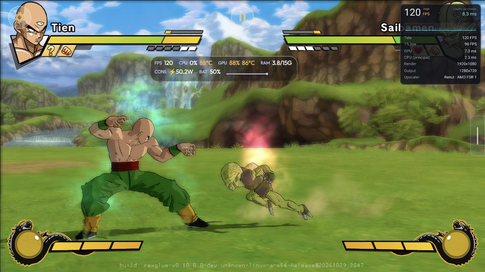<br>
  <sub>AYN Odin 3, Renut at 1080p and 120 FPS (native) in the campaign.</sub>
</p>

**Controls**
- Touch controls made not to cover the game: an 8-way D-pad (or analog stick), buttons with the game's
  look, transparent, shown when you touch and hidden when you use a controller.
- Separate layouts for fights, menus and free camera (switched automatically), a layout editor and macros
  (combination or sequence), port buttons (Ki, Aura Spark, Transform, Blow-away, Pursuit, menu).
- Physical controllers with deadzone and vibration. The game reads the controller at the moment it asks
  for it (less delay), sign-in works with the pad on any player (2-4), and controllers SDL has no mapping
  for use a generic one.

**Online**
- **Local network (Wi-Fi)**, the PC version's LAN method: one device hosts, the other types its IP.
  **Experimental**: not yet tested between two devices. Both need the same APK.
- The internet lobby (Ranked, leaderboards) is not on Android yet, and there is no cross-play with PC.

**Diagnostics**
- If the game closes with the Renut, the app says so and offers **Export logs**; only from the 2nd close in
  a row does it ask whether to use Xenia for now. It never switches by itself.
- **Render self-test** (in-game menu → System, about 1.5 min, in an offline fight): turns off each Xenia
  renderer shortcut, compares the images and tells which one breaks the picture and how much each is worth.
- **Export logs** (About tab, Debug tab or in-game menu → System): a `.zip` in Download with the logs, the
  self-test result and the last frame capture.

The full list, feature by feature, against the PC version: [docs/COMPATIBILIDADE.md](docs/COMPATIBILIDADE.md)
(Portuguese).

## Performance

**Renut (0.2.0, default).** The native renderer from
[Zandatsu](https://github.com/dfdx047/Zandatsu): it draws the game's Direct3D straight to Vulkan instead of
emulating the Xbox 360 GPU. Auto always uses it, on every GPU. For Burst Limit it gained, among other
things: the characters' toon shading with the right colours (hair and clothes), particles and the Now
Loading screen without squares, widescreen, 120 FPS pacing, the descriptor layout each driver accepts (the
Honor Magic 7 Pro's closed at start) and an interface thread that no longer takes a whole core (on the
Odin 3 the CPU went from 103 °C to 82 °C on average).

<table>
  <tr>
    <td>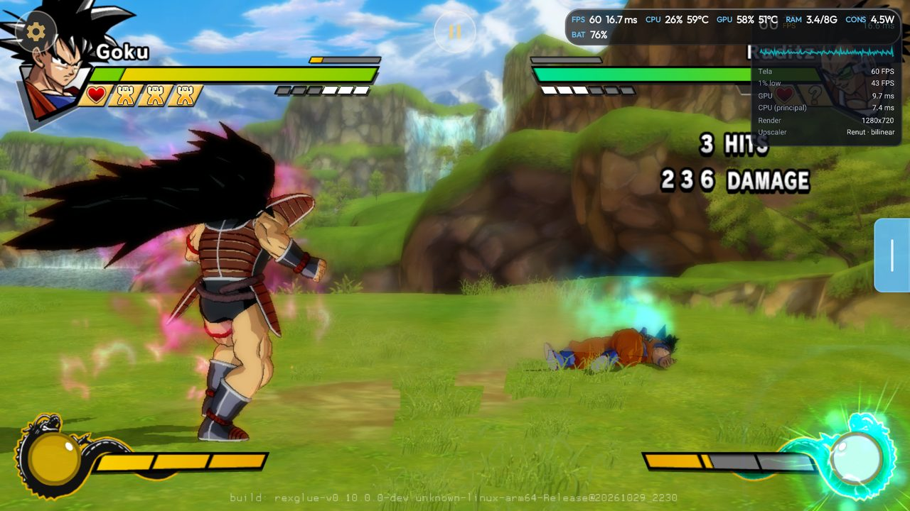</td>
    <td>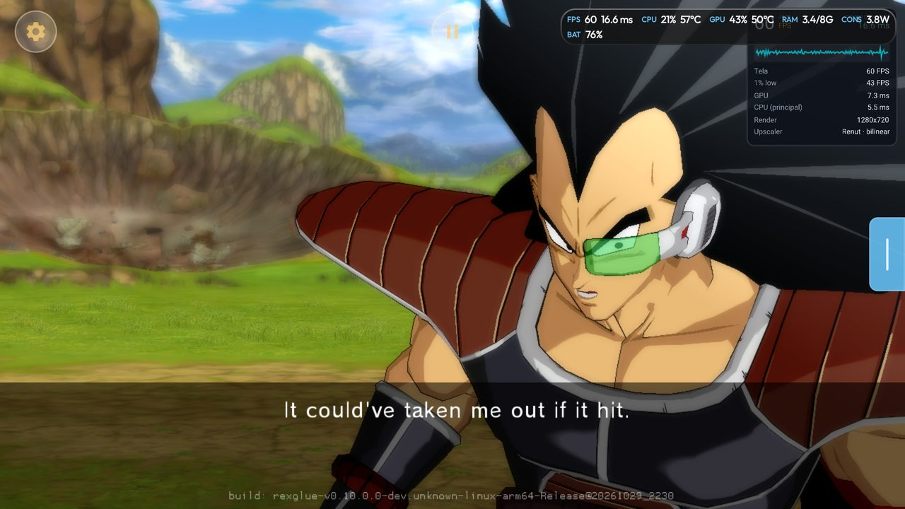</td>
    <td width="24%">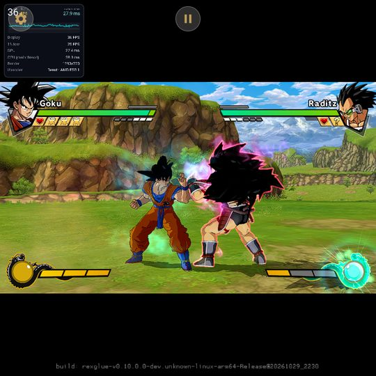</td>
  </tr>
  <tr>
    <td><sub>Retroid Pocket 5, Renut at 720p: 60 FPS in fights.</sub></td>
    <td><sub>Retroid Pocket 5, campaign: 60 FPS.</sub></td>
    <td><sub>RG Cube (1:1 screen), Renut.</sub></td>
  </tr>
</table>

**Xenia.** Burst Limit Recompiled's renderer emulates the Xbox 360 GPU and is heavy for a phone. Dragon
Burst replaces its most expensive parts with a **native renderer**, step by step, each with a switch and
validated by the self-test:

1. the final image presented directly, without the last full-screen copy;
2. linear depth computed by compute, straight from the depth buffer;
3. lean post-processing (empty draws and repeated or unread resolves skipped) and the outline,
   downsample, blur and glow composite done by compute;
4. the post-processing passes drawing straight into their target texture.

Plus the Dragon Fury GPU optimizations and three Mali optimizations (direct copy to the texture, resolves
served by step 4, unread writes). On the Retroid Pocket 5, at 720p with every effect, fights went from
12-16 FPS to up to 60 FPS. The method and tools are in **[OptXbox](https://github.com/dfdx047/Optxbox)**;
the history with the numbers of every round, in [docs/ESTADO.md](docs/ESTADO.md) and
[docs/renut/PROGRESSO.md](docs/renut/PROGRESSO.md) (Portuguese).

## Tested devices

| Device | Processor / GPU | Driver | Result |
|---|---|---|---|
| Retroid Pocket 5 | Snapdragon 865 / Adreno 650 | system (Qualcomm) | Renut at 720p: a steady 60 FPS in fights and in the campaign (GPU 8-11 ms). Xenia at 720p with every effect: up to 60 FPS in fights, about 47-50 FPS in heavy scenes. |
| Retroid Pocket 5, 480+ profile | Snapdragon 865 / Adreno 650 (GPU limited) | system / Turnip | Renut with FSR: 60 FPS at 480p and at 540p in fights and in the campaign (minimum 59 at 540p). |
| Retroid Pocket 5 | Snapdragon 865 / Adreno 650 | Turnip (Mesa 25.3 and 26.3) | Wrong image (olive background, swapped colours). Use the system driver. |
| Anbernic RG Cube | Unisoc T770 / Mali-G57 MC4 | system | Renut with "Screen" (360p): 60 FPS in fights and in the campaign; 480p 59 FPS; 540p 49 FPS in fights and 55 in the campaign (GPU bound). Xenia at 720p with effects: 22-24 FPS. |
| AYN Odin 3 | Snapdragon 8 Elite / Adreno 830, 120 Hz screen | system | Renut at 1080p: 60 and 120 FPS (native) in fights and in the campaign, a steady 120 over 15 minutes. 120 interpolated: 117 on screen (Renut 1080p), 120 (Xenia 720p). |
| Honor Magic 7 Pro | Snapdragon 8 Elite / Adreno 830, 2800x1280 screen | system | Renut at 720p in widescreen (2.19:1): 60 FPS in fights (GPU 9-10 ms) and in the campaign (minimum 59.7). |

## Hardware

- **Entry level:** Unisoc T770 / Mali-G57 MC4 class with the Renut: 60 FPS with the "Screen" resolution
  on a small screen (RG Cube, 360p) or at 480p.
- **60 FPS at 720p:** Snapdragon 865 (Adreno 650) with the Renut and the system driver.
- **Recommended:** Snapdragon 8 Gen 2 or newer (e.g. AYN Odin 3), which gives 1080p and 120 FPS (with a
  120 Hz screen).
- **Not tested:** anything below a Mali-G57 MC4 or a mid-range Adreno 6xx. The Minimum preset (480p)
  exists for those devices, but it has not been measured.
- Always: Android 11 or newer, arm64, Vulkan and about 6 GB free for the game data.

## Known issues

- **USA (NTSC-U)** version of the game only.
- **Widescreen only with the Renut.** With Xenia the picture stays 16:9 (the HUD is not repositioned on
  Vulkan).
- In widescreen the Renut draws 1280 columns and stretches them to the screen width: the picture is a
  little softer horizontally than in 16:9.
- In widescreen the **main menu** keeps dark bars at the sides (its pieces do not cover the screen; the PC
  version is the same). The title, Versus and stage select reach the edges.
- **AYN Odin 3:** the numbers above are from before the Honor Magic 7 Pro fix (which changed the descriptor
  layout on Qualcomm drivers); they still need measuring again.
- **Turnip on the Adreno 650** (Retroid Pocket 5) gives a wrong image: use the system driver.
- **Xenia:** on the title screen Start may need several presses (the Renut answers the first).
- **Xenia above 720p** (2K, 4K): the native render turns off. 1080p is Renut only.
- **120 FPS:** experimental; online has not been checked at 120.
- **Online:** local network only, experimental and not yet tested between two devices; no internet lobby
  (Ranked, leaderboards) and no cross-play with PC.
- Texture packs and mods have not been tested with large packs on the devices yet.

## Install

1. Download the APK from [Releases](https://github.com/dfdx047/Dragon-Burst/releases) and install it
   (Android asks you to allow installing unknown apps).
2. Open Dragon Burst and tap **Import .iso** (your disc's `.iso`) or **Import folder**. Only the USA
   (NTSC-U) version works.
3. Pick a preset in the Performance tab (the app suggests the one for your device); on a screen wider than
   16:9 turn on **Widescreen** in Aspect ratio. Tap **PLAY**.

Next versions arrive through the app itself.

## Legal

No game files are included and nothing is downloaded: the app only uses the copy you import. Dump your own
disc; do not ask for or share ISOs. A fan project, unofficial and non-commercial. Dragon Ball belongs to
Bird Studio/Shueisha, Toei Animation and Bandai Namco. The icon and the banner are original drawings made
for this project.

## Building

The game code is generated from your own USA `default.xex`, so the build needs your copy. It needs NDK
28.2.13676358, JDK 17, clang 20+, cmake and ninja. Step by step in
[docs/ESTADO.md](docs/ESTADO.md#como-compilar-pc-linux) (Portuguese). Summary:

```bash
bash tools/setup-external.sh
bash tools/apply-patches.sh
bash tools/apply-renut-patches.sh
bash tools/codegen.sh /path/to/BurstLimit.iso   # or default.xex
./gradlew assembleRelease
```

`bash tools/install.sh` installs on the devices connected through adb. The SDK and game patches are in
`patches/`, the Renut ones in `patches/renut/`. The icon is generated by `tools/icon_gen.py`.

## Reporting problems

1. In an offline fight, open the in-game menu → System → **Render self-test** and wait for it to finish.
2. Tap **Export logs** (in the same menu or in the About tab): the `DragonBurst-logs-*.zip` file goes to
   the Download folder.
3. Open a GitHub issue with the device, the preset/options used (renderer, resolution, aspect ratio), what
   happened and the `.zip`.

## Credits

- iExplosiveRage: [DBZ Burst Limit Recompiled](https://github.com/iExplosiveRage/DBZ-Burst-Limit-Recompiled),
  including the v7.3 widescreen.
- The ReXGlue SDK team and the [Xenia](https://github.com/xenia-project/xenia) project, where the Xenia
  renderer comes from.
- [Zandatsu](https://github.com/dfdx047/Zandatsu), where the Renut comes from.
- NovaPowers (DBZ Budokai 3 HD), whose Android port, Dragon Fury, this one starts from.
- SDL, libadrenotools (bylaws) and the people who build the Turnip/Mesa drivers (Mr. Purple, StevenMXZ,
  K11MCH1).

Made by dfdx047 · [Discord](https://discord.gg/nXSANX9V6k) · [YouTube](https://www.youtube.com/@DFDX47) ·
[Ko-fi](https://ko-fi.com/dfdx047)
