<p align="center"></p>

# 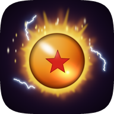 Dragon Burst

[Português](README.md) · [English](README.en.md) · **Español**

Port nativo para Android de **[DBZ Burst Limit Recompiled](https://github.com/iExplosiveRage/DBZ-Burst-Limit-Recompiled)**
(iExplosiveRage), la recompilación estática de Dragon Ball Z: Burst Limit de Xbox 360. El código del juego
se ejecuta de forma nativa en arm64 (no se emula), sobre el runtime del ReXGlue SDK en Vulkan y la base de
Dragon Fury (el port Android de DBZ Budokai 3 HD). La imagen sale del **Renut**, un renderizador nativo que
dibuja el Direct3D del juego directamente en Vulkan.

> **No incluye archivos del juego.** Necesitas tu propia copia legal, versión **USA (NTSC-U)**.
>
> **Versión 0.2.0.** Probada en la Retroid Pocket 5, la Anbernic RG Cube, la AYN Odin 3 y el Honor Magic 7
> Pro. Lo que aún no se probó en un dispositivo está marcado como **experimental**. Todo lo que cambió,
> versión a versión: [CHANGELOG.md](CHANGELOG.md).

<p align="center">
  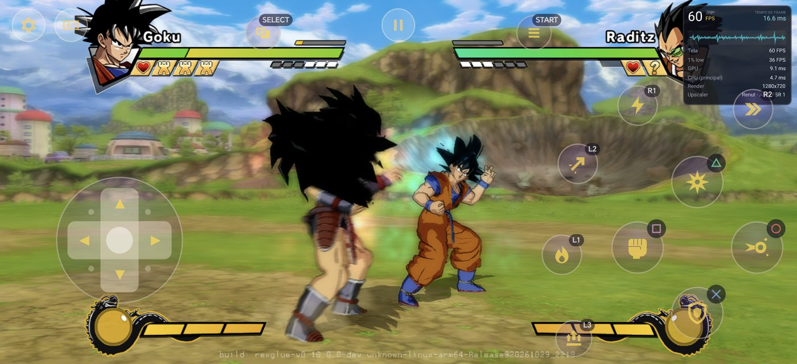<br>
  <sub>Honor Magic 7 Pro (2800x1280, 2,19:1), Renut a 720p en panorámico: 60 FPS en combate.</sub>
</p>

## Novedades de la 0.2.0

- **Renut**, el renderizador nativo, por defecto en todas las GPU (Adreno con el driver del sistema o
  Turnip, Mali). Xenia sigue como opción.
- **Panorámico** en pantallas más anchas que 16:9: más escena a los lados y el HUD en su forma. Se activa
  y desactiva en cualquier momento, sin reiniciar.
- **60 FPS** en la Retroid Pocket 5 a 720p y en la RG Cube con la resolución "Pantalla"; **120 FPS** en la
  AYN Odin 3 a 1080p, estables durante 15 minutos seguidos.
- El juego **se pausa cuando sale de la pantalla** (menos batería y calor) y gasta menos CPU.
- El launcher tiene la **barra de pestañas abajo** y un **icono nuevo**.
- Las correcciones de la **versión de PC v7.3** (menos retraso en los controles, inicio de sesión con
  cualquier mando, logros por perfil, packs de texturas).

## Panorámico

En pantallas más anchas que 16:9 (la mayoría de los móviles), con el Renut, la opción **Panorámico**
muestra más de la escena a los lados, con la forma de la pantalla, sin estirar a los personajes. El HUD
mantiene su forma: las barras de vida y los retratos van a los extremos, el reloj queda en el centro, y los
subtítulos y los Drama Pieces no se deforman. Es el panorámico de la versión de PC v7.3, con la parte de la
GPU hecha para el Renut.

- **Dónde:** Rendimiento → Relación de aspecto → **Original 16:9 / Estirar para llenar / Panorámico**, o en
  el menú del juego (Back + Start) → Imagen. La opción solo aparece si la pantalla es más ancha que 16:9 y
  el renderizador es el Renut.
- **Se cambia en vivo:** en el menú del juego el cambio vale en el fotograma siguiente, en mitad de un
  combate o de una cinemática.

<p align="center">
  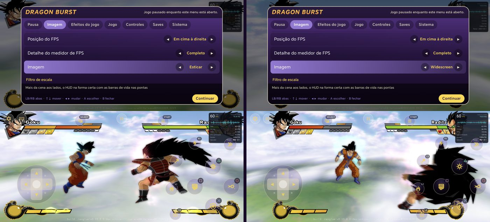<br>
  <sub>El mismo momento, cambiado en el menú del juego: Estirar (izquierda, personajes ensanchados) y
  Panorámico (derecha, más escena y las proporciones correctas).</sub>
</p>

<table>
  <tr>
    <td>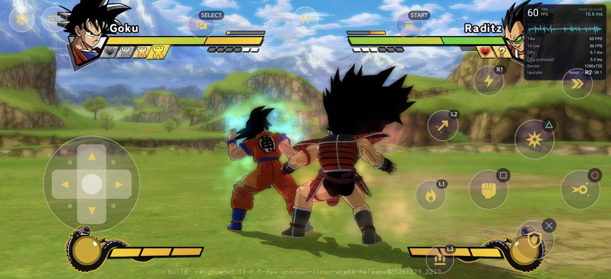</td>
    <td>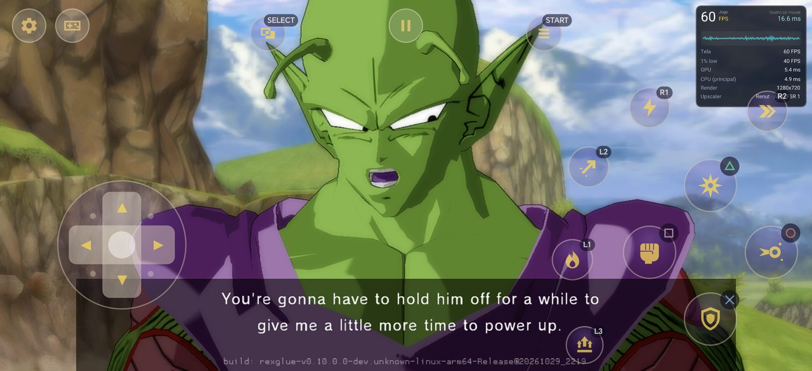</td>
  </tr>
  <tr>
    <td><sub>Campaña (Z Chronicles): 60 FPS, mínimo 59,7.</sub></td>
    <td><sub>Cinemáticas a pantalla completa, subtítulos en su forma.</sub></td>
  </tr>
</table>

<p align="center">
  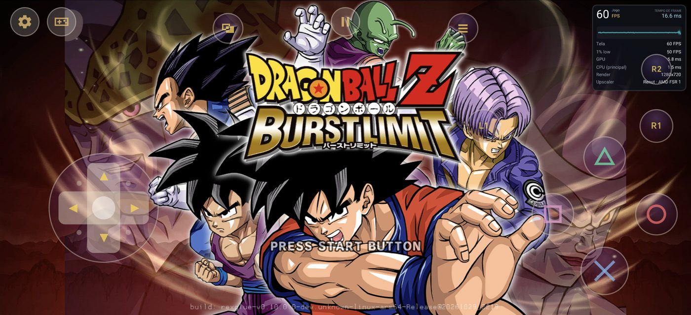<br>
  <sub>Pantalla de título: el fondo llega a los extremos, personajes y texto sin deformar.</sub>
</p>

## Launcher

<p align="center">
  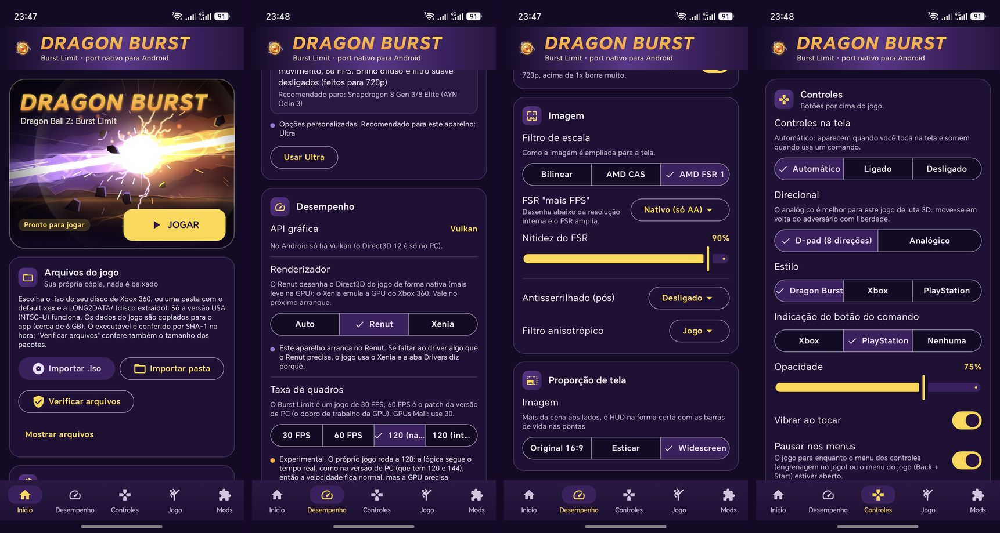<br>
  <sub>Inicio, Rendimiento (renderizador y tasa de fotogramas), Relación de aspecto y Controles (la app en
  portugués).</sub>
</p>

<p align="center">
  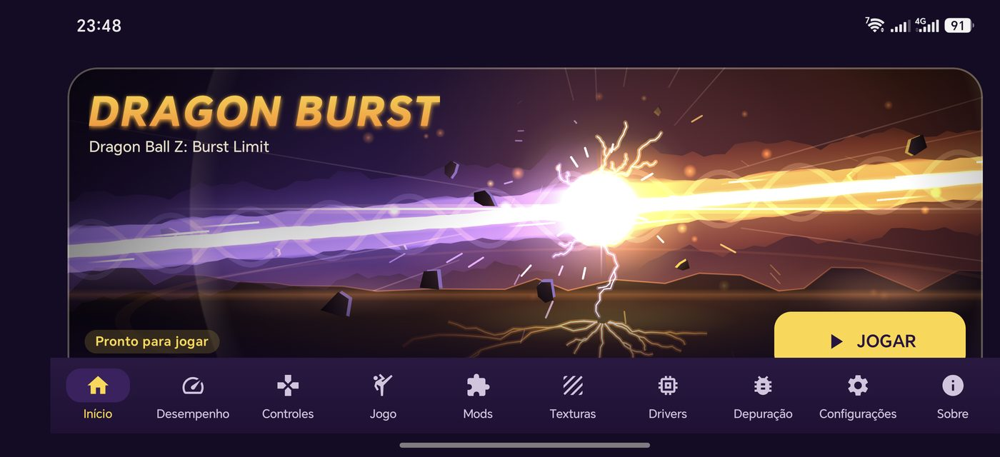<br>
  <sub>En horizontal las diez pestañas caben a la vez en la barra de abajo.</sub>
</p>

- Importar el juego directamente del `.iso` o de una carpeta extraída (`default.xex` + `LONG2DATA/`). Solo
  la versión USA: la app comprueba el ejecutable y avisa si el disco es de otro juego, de otra región, está
  modificado o cortado. **Verificar archivos** comprueba la instalación después.
- El código del juego va cifrado en el APK y solo se abre con el `default.xex` de tu disco. En el primer
  JUGAR la app lo prepara a partir del juego importado (con barra de progreso); al venir de la 0.1.x no hace
  falta importar de nuevo.
- **Barra de pestañas abajo**, en vertical y en horizontal: Inicio, Rendimiento, Controles, Juego, Mods,
  Texturas, Drivers, Depuración, Ajustes y Acerca de. En vertical la barra se desplaza y mantiene a la vista
  la pestaña elegida.
- **Icono nuevo**: una esfera naranja con una estrella, en un aura dorada con chispas (un dibujo
  original). Tiene también la versión monocromática para los iconos temáticos de Android 13+.
- Tema propio, portugués, inglés y español, acceso directo en la pantalla de inicio.
- **Actualización automática**: al abrir, la app busca una versión nueva en las Releases de GitHub, muestra
  lo que cambió (en el idioma de la app), descarga el APK y abre el instalador.

## Qué incluye

**Juego** (las opciones de la versión de PC que funcionan en Android)
- 30 FPS (original) o 60 FPS, y los modos de 120 FPS (abajo).
- Trajes del modo historia, escenarios extra, empezar transformado (RB/LB), cargar ki (mantener L3),
  personajes extra de mods, iconos de botones Xbox/PlayStation/Switch, "Online" en vez de "Xbox LIVE",
  sonidos de menú, campo de visión, cámara libre y congelar el juego (modo foto).
- Menú del juego propio de Android (Back + Start, o el botón de pausa): imagen, efectos, juego, controles,
  partida y sistema, con el juego en pausa.
- **Pausa fuera de la pantalla**: Inicio, recientes o la pantalla apagada detienen el combate, el dibujo y
  el sonido; al volver el juego sigue donde estaba.
- **Partidas**: exportar/importar desde el menú del juego; el mismo `.zip` que la versión de PC y Xenia.
  La pestaña Juego copia las partidas desde y hacia la carpeta Download. Logros guardados por perfil.

**Mods y texturas**
- Mods en el formato de la versión de PC (`mods/`, `mod.toml`): instalar `.zip`, activar/desactivar, tipo
  detectado, aviso de conflictos y de carpeta de más.
- **Packs de texturas HD** (la sustitución de texturas se portó a Vulkan): varios packs, uno activo,
  comprobación de nombres y formatos, precarga opcional y extracción de las texturas originales para crear
  packs. Como en la v7.3 de PC: alfa premultiplicado, imágenes de más de 8192 reducidas, mips como los del
  juego y colores correctos en las texturas ARGB.

**Gráficos**
- **Renderizador**: Auto (por defecto, usa siempre el Renut), Renut o Xenia.
- **5 preajustes** (Mínimo, Ligero, Equilibrado, Alto, Ultra) con los procesadores recomendados para cada
  uno; la app sugiere el de tu dispositivo.
- Resolución interna **Pantalla, 480p, 540p, 720p, 1080p (solo Renut), 2K (1440p) o 4K (2160p)**.
  "Pantalla" dibuja a la altura que ocupa la imagen en la pantalla; en pantallas pequeñas la app la sugiere
  en el primer arranque.
- **Relación de aspecto**: Original 16:9, Estirar para llenar o **Panorámico** (arriba).
- Efectos del juego activables (profundidad de campo, brillo, desenfoque de movimiento, filtro suave), AMD
  FSR 1 + CAS, FXAA, filtro anisotrópico. En los escalados grandes (540p o 480p en una pantalla 1080p) el
  FSR llega hasta 720p y el resto es bilineal, lo que ahorra casi la mitad de la GPU por cuadro.
- **Drivers Vulkan**: el del sistema o Turnip (Mesa) mediante libadrenotools, descargados de los
  repositorios de la comunidad o importados. La pestaña Drivers muestra el nivel de soporte de Turnip para
  tu Snapdragon. **Turnip es experimental en este port** (mira los dispositivos probados).

**120 FPS** (solo en pantallas de 120 Hz; en las demás las opciones no aparecen)
- **120 (nativo)**: el propio juego va a 120, como en la versión de PC, a la misma velocidad de juego. La
  GPU necesita cada cuadro en menos de 8,3 ms. En la AYN Odin 3 con el Renut a 1080p: 120 estables en
  combate y en la campaña, durante 15 minutos seguidos.
- **120 (interpolado)**: el juego va a 60 y la GPU genera un fotograma entre cada dos reales. Un fotograma
  más de latencia (unos 8 ms); el HUD sigue nítido. En la Odin 3: 117 en pantalla con el Renut a 1080p, 120
  con Xenia a 720p.
- Los dos siguen siendo **experimentales**: el online no se comprobó a 120.

<p align="center">
  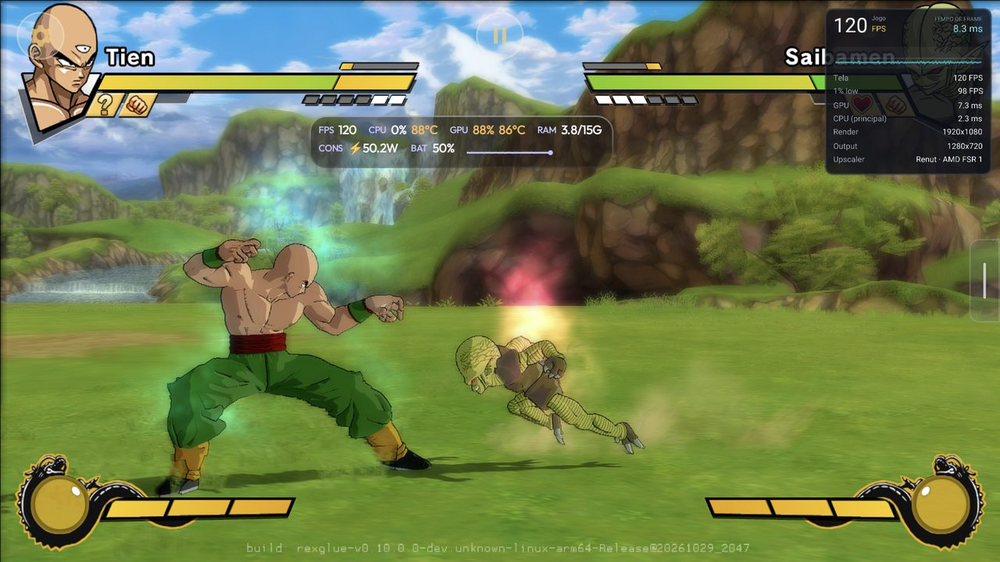<br>
  <sub>AYN Odin 3, Renut a 1080p y 120 FPS (nativo) en la campaña.</sub>
</p>

**Controles**
- Controles táctiles pensados para no tapar el juego: cruceta de 8 direcciones (o stick analógico), botones
  con el estilo del juego, transparentes, que aparecen al tocar y se ocultan al usar un mando.
- Diseños separados para combate, menús y cámara libre (cambian solos), editor de diseño y macros
  (combinación o secuencia), botones del port (Ki, Aura Spark, Transformar, Lanzamiento, Persecución,
  menú).
- Mandos físicos con zona muerta y vibración. El juego lee el mando en el momento en que lo pide (menos
  retraso), el inicio de sesión funciona con el mando en cualquier jugador (2-4), y los mandos sin mapeo en
  SDL usan uno genérico.

**Online**
- **Red local (Wi-Fi)**, el método LAN de la versión de PC: un dispositivo es el anfitrión y el otro
  escribe su IP. **Experimental**: aún sin probar entre dos dispositivos. Los dos necesitan el mismo APK.
- El lobby por internet (Ranked, clasificaciones) aún no está en Android, y no hay juego cruzado con PC.

**Diagnóstico**
- Si el juego se cierra con el Renut, la app lo avisa y ofrece **Exportar logs**; solo a partir del 2.º
  cierre seguido pregunta si quieres usar Xenia por ahora. Nunca cambia solo.
- **Autotest del render** (menú del juego → Sistema, cerca de 1,5 min, en un combate offline): desactiva
  cada atajo del renderizador Xenia, compara las imágenes y dice cuál estropea la imagen y cuánto vale cada
  uno.
- **Exportar logs** (pestaña Acerca de, pestaña Depuración o menú del juego → Sistema): un `.zip` en
  Download con los logs, el resultado del autotest y la última captura de fotogramas.

La lista completa, función por función, frente a la versión de PC:
[docs/COMPATIBILIDADE.md](docs/COMPATIBILIDADE.md) (en portugués).

## Rendimiento

**Renut (0.2.0, por defecto).** El renderizador nativo de
[Zandatsu](https://github.com/dfdx047/Zandatsu): dibuja el Direct3D del juego directamente en Vulkan, sin
emular la GPU de Xbox 360. Auto lo usa siempre, en todas las GPU. Para Burst Limit ganó, entre otras
cosas: el sombreado toon de los personajes con los colores correctos (pelo y ropa), las partículas y la
pantalla Now Loading sin cuadrados, el panorámico, el ritmo de 120 FPS, el layout de descriptores que
acepta cada driver (el del Honor Magic 7 Pro se cerraba al arrancar) y un hilo de interfaz que ya no ocupa
un núcleo entero (en la Odin 3 la CPU bajó de 103 °C a 82 °C de media).

<table>
  <tr>
    <td>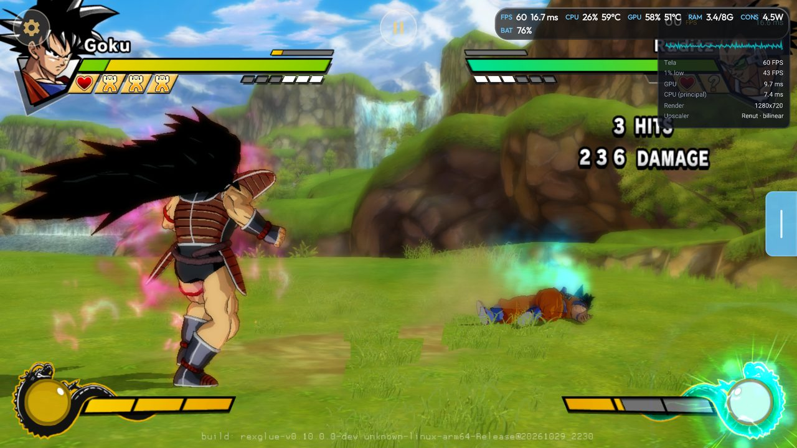</td>
    <td>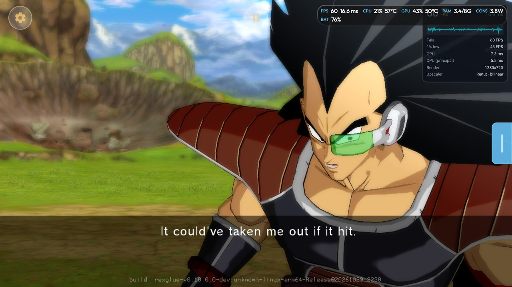</td>
    <td width="24%">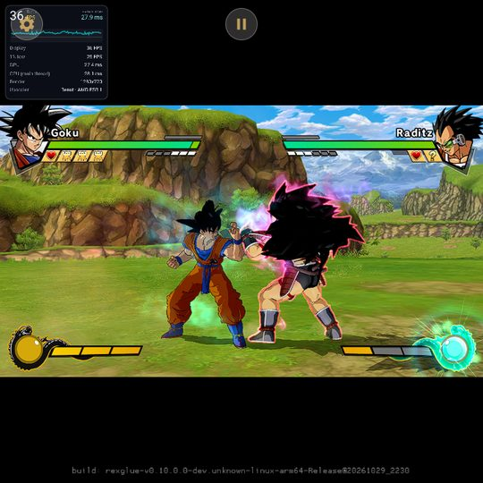</td>
  </tr>
  <tr>
    <td><sub>Retroid Pocket 5, Renut a 720p: 60 FPS en combate.</sub></td>
    <td><sub>Retroid Pocket 5, campaña: 60 FPS.</sub></td>
    <td><sub>RG Cube (pantalla 1:1), Renut.</sub></td>
  </tr>
</table>

**Xenia.** El renderizador de Burst Limit Recompiled emula la GPU de Xbox 360 y es pesado para un móvil.
Dragon Burst cambia sus partes más caras por un **render nativo**, paso a paso, cada uno con interruptor y
validado por el autotest:

1. la imagen final presentada directamente, sin la última copia de pantalla completa;
2. la profundidad lineal calculada por compute, directamente del depth buffer;
3. el posprocesado ligero (draws vacíos y resolves repetidos o sin lector omitidos) y el contorno, la
   reducción, el desenfoque y la composición del brillo hechos por compute;
4. los pases del posprocesado dibujando directamente en su textura de destino.

Más las optimizaciones de GPU de Dragon Fury y tres optimizaciones para Mali (copia directa a la textura,
resolves servidos por el paso 4, escrituras sin lector). En la Retroid Pocket 5, a 720p con todos los
efectos, el combate pasó de 12-16 FPS a hasta 60 FPS. El método y las herramientas están en
**[OptXbox](https://github.com/dfdx047/Optxbox)**; el historial con los números de cada ronda, en
[docs/ESTADO.md](docs/ESTADO.md) y [docs/renut/PROGRESSO.md](docs/renut/PROGRESSO.md) (en portugués).

## Dispositivos probados

| Dispositivo | Procesador / GPU | Driver | Resultado |
|---|---|---|---|
| Retroid Pocket 5 | Snapdragon 865 / Adreno 650 | del sistema (Qualcomm) | Renut a 720p: 60 FPS estables en combate y en la campaña (GPU 8-11 ms). Xenia a 720p con todos los efectos: hasta 60 FPS en combate, unos 47-50 FPS en las escenas pesadas. |
| Retroid Pocket 5, perfil 480+ | Snapdragon 865 / Adreno 650 (GPU limitada) | del sistema / Turnip | Renut con FSR: 60 FPS a 480p y a 540p en combate y en la campaña (mínimo 59 a 540p). |
| Retroid Pocket 5 | Snapdragon 865 / Adreno 650 | Turnip (Mesa 25.3 y 26.3) | Imagen incorrecta (fondo color oliva, colores cambiados). Usa el driver del sistema. |
| Anbernic RG Cube | Unisoc T770 / Mali-G57 MC4 | del sistema | Renut con "Pantalla" (360p): 60 FPS en combate y en la campaña; 480p 59 FPS; 540p 49 FPS en combate y 55 en la campaña (limitado por la GPU). Xenia a 720p con efectos: 22-24 FPS. |
| AYN Odin 3 | Snapdragon 8 Elite / Adreno 830, pantalla de 120 Hz | del sistema | Renut a 1080p: 60 y 120 FPS (nativo) en combate y en la campaña, 120 estables durante 15 minutos. 120 interpolado: 117 en pantalla (Renut 1080p), 120 (Xenia 720p). |
| Honor Magic 7 Pro | Snapdragon 8 Elite / Adreno 830, pantalla 2800x1280 | del sistema | Renut a 720p en panorámico (2,19:1): 60 FPS en combate (GPU 9-10 ms) y en la campaña (mínimo 59,7). |

## Hardware

- **Entrada:** clase Unisoc T770 / Mali-G57 MC4 con el Renut: 60 FPS con la resolución "Pantalla" en una
  pantalla pequeña (RG Cube, 360p) o a 480p.
- **60 FPS a 720p:** Snapdragon 865 (Adreno 650) con el Renut y el driver del sistema.
- **Recomendado:** Snapdragon 8 Gen 2 o más nuevo (p. ej. AYN Odin 3), que da 1080p y los 120 FPS (con una
  pantalla de 120 Hz).
- **Sin probar:** cualquier cosa por debajo de una Mali-G57 MC4 o de una Adreno 6xx de gama media. El
  preajuste Mínimo (480p) existe para esos dispositivos, pero no se midió.
- **CPU ARMv8.0** (Snapdragon 660/665, Exynos 9611 y otros solo con Cortex-A73/A53): desde la 0.2.2 el APK lleva
  un conjunto propio para ellas, elegido solo según la CPU. Arranca en el Mi A3 (Snapdragon 665); rendimiento sin medir.
- Siempre: Android 11 o más nuevo, arm64, Vulkan y unos 6 GB libres para los datos del juego.

## Problemas conocidos

- Solo la versión **USA (NTSC-U)** del juego.
- **Panorámico solo con el Renut.** Con Xenia la imagen queda en 16:9 (el HUD no se recoloca en Vulkan).
- En panorámico el Renut dibuja 1280 columnas y las estira al ancho de la pantalla: la imagen queda un
  poco más suave en horizontal que en 16:9.
- En panorámico el **menú principal** queda con franjas oscuras a los lados (sus piezas no cubren la
  pantalla; en la versión de PC es igual). El título, el Versus y la elección de escenario llegan a los
  extremos.
- **AYN Odin 3:** los números de arriba son de antes de la corrección del Honor Magic 7 Pro (que cambió el
  layout de descriptores en los drivers de Qualcomm); falta medirlos de nuevo.
- **Turnip en la Adreno 650** (Retroid Pocket 5) da una imagen incorrecta: usa el driver del sistema.
- **Xenia:** en la pantalla de título Start puede necesitar varias pulsaciones (el Renut responde a la
  primera).
- **Xenia por encima de 720p** (2K, 4K): el render nativo se desactiva. El 1080p es solo del Renut.
- **120 FPS:** experimentales; el online no se comprobó a 120.
- **Online:** solo red local, experimental y aún sin probar entre dos dispositivos; sin lobby por internet
  (Ranked, clasificaciones) y sin juego cruzado con PC.
- Los packs de texturas y los mods aún no se probaron con packs grandes en los dispositivos.

## Instalar

1. Descarga el APK en [Releases](https://github.com/dfdx047/Dragon-Burst/releases) e instálalo (Android
   pide permitir la instalación de apps desconocidas).
2. Abre Dragon Burst y toca **Importar .iso** (el `.iso` de tu disco) o **Importar carpeta**. Solo
   funciona la versión USA (NTSC-U).
3. Elige un preajuste en la pestaña Rendimiento (la app sugiere el de tu dispositivo); en una pantalla más
   ancha que 16:9 activa **Panorámico** en Relación de aspecto. Toca **JUGAR**.

Las próximas versiones llegan desde la propia app.

## Aviso legal

No incluye archivos del juego y no se descarga nada: la app solo usa la copia que importas. Haz el dump de
tu propio disco; no pidas ni compartas ISOs. Proyecto de fans, no oficial y sin fines comerciales. Dragon
Ball pertenece a Bird Studio/Shueisha, Toei Animation y Bandai Namco. El icono y el banner son dibujos
originales del proyecto.

## Compilar

El código del juego se genera a partir de tu propio `default.xex` USA, por eso el build necesita tu copia.
Necesita el NDK 28.2.13676358, JDK 17, clang 20+, cmake y ninja. Paso a paso en
[docs/ESTADO.md](docs/ESTADO.md#como-compilar-pc-linux) (en portugués). Resumen:

```bash
bash tools/setup-external.sh
bash tools/apply-patches.sh
bash tools/apply-renut-patches.sh
bash tools/codegen.sh /path/to/BurstLimit.iso   # or default.xex
./gradlew assembleRelease
```

`bash tools/install.sh` instala en los dispositivos conectados por adb. Los parches del SDK y del juego
están en `patches/`, los del Renut en `patches/renut/`. El icono lo genera `tools/icon_gen.py`.

## Reportar problemas

1. En un combate offline, abre el menú del juego → Sistema → **Autotest del render** y espera a que
   termine.
2. Toca **Exportar logs** (en el mismo menú o en la pestaña Acerca de): el archivo
   `DragonBurst-logs-*.zip` va a la carpeta Download.
3. Abre una issue en GitHub con el dispositivo, el preajuste/opciones usadas (renderizador, resolución,
   relación de aspecto), lo que pasó y el `.zip`.

## Créditos

- iExplosiveRage: [DBZ Burst Limit Recompiled](https://github.com/iExplosiveRage/DBZ-Burst-Limit-Recompiled),
  incluido el panorámico de la v7.3.
- El equipo del ReXGlue SDK y el proyecto [Xenia](https://github.com/xenia-project/xenia), de donde viene
  el renderizador Xenia.
- [Zandatsu](https://github.com/dfdx047/Zandatsu), de donde viene el Renut.
- NovaPowers (DBZ Budokai 3 HD), de cuyo port Android, Dragon Fury, parte este.
- SDL, libadrenotools (bylaws) y quienes compilan los drivers Turnip/Mesa (Mr. Purple, StevenMXZ,
  K11MCH1).

Desarrollado por dfdx047 · [Discord](https://discord.gg/nXSANX9V6k) · [YouTube](https://www.youtube.com/@DFDX47) ·
[Ko-fi](https://ko-fi.com/dfdx047)
