<p align="center"></p>

# 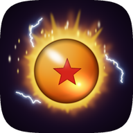 Dragon Burst

**Português** · [English](README.en.md) · [Español](README.es.md)

Port nativo para Android do **[DBZ Burst Limit Recompiled](https://github.com/iExplosiveRage/DBZ-Burst-Limit-Recompiled)**
(iExplosiveRage), a recompilação estática do Dragon Ball Z: Burst Limit de Xbox 360. O código do jogo roda
nativo em arm64 (não é emulado), sobre o runtime do ReXGlue SDK em Vulkan e a base do Dragon Fury (port
Android do DBZ Budokai 3 HD). A imagem sai do **Renut**, um renderizador nativo que desenha o Direct3D do
jogo direto em Vulkan.

> **Nenhum arquivo do jogo vem incluído.** Você precisa da sua própria cópia legal, versão **USA (NTSC-U)**.
>
> **Versão 0.2.0.** Testada no Retroid Pocket 5, no Anbernic RG Cube, no AYN Odin 3 e no Honor Magic 7 Pro.
> O que ainda não foi testado num aparelho está marcado como **experimental**. Tudo o que mudou, versão a
> versão: [CHANGELOG.md](CHANGELOG.md).

<p align="center">
  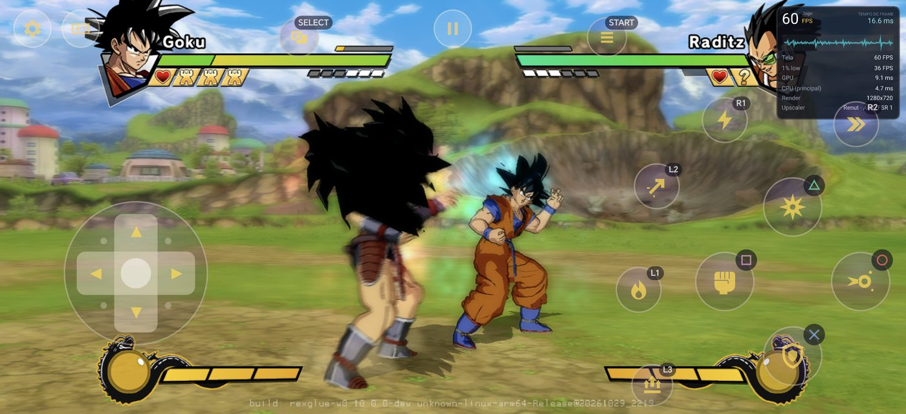<br>
  <sub>Honor Magic 7 Pro (2800x1280, 2,19:1), Renut a 720p em widescreen: 60 FPS na luta.</sub>
</p>

## Novidades da 0.2.0

- **Renut**, o renderizador nativo, por padrão em todas as GPUs (Adreno com o driver do sistema ou Turnip,
  Mali). O Xenia continua como opção.
- **Widescreen** nas telas mais largas que 16:9: mais cena aos lados e o HUD na forma certa. Liga e
  desliga a qualquer momento, sem reiniciar.
- **60 FPS** no Retroid Pocket 5 a 720p e no RG Cube com a resolução "Tela"; **120 FPS** no AYN Odin 3 a
  1080p, estáveis em 15 minutos seguidos.
- O jogo **pausa quando sai da tela** (menos bateria e calor) e gasta menos CPU.
- O launcher tem a **barra de abas em baixo** e um **ícone novo**.
- As correções da **versão de PC v7.3** (comandos com menos atraso, login com qualquer comando, conquistas
  por perfil, packs de texturas).

## Widescreen

Nas telas mais largas que 16:9 (a maioria dos celulares), com o Renut, a opção **Widescreen** mostra mais
da cena aos lados, na forma da tela, sem esticar as personagens. O HUD fica na forma certa: as barras de
vida e os retratos vão para as pontas, o relógio fica ao centro, e as legendas e os Drama Pieces não se
deformam. É o widescreen da versão de PC v7.3, com o lado da GPU feito para o Renut.

- **Onde:** Desempenho → Proporção de tela → **Original 16:9 / Esticar / Widescreen**, ou no menu do jogo
  (Back + Start) → Imagem. A opção só aparece quando a tela é mais larga que 16:9 e o renderizador é o Renut.
- **Liga e desliga ao vivo:** no menu do jogo a troca vale no quadro seguinte, a meio de uma luta ou de uma
  cutscene.

<p align="center">
  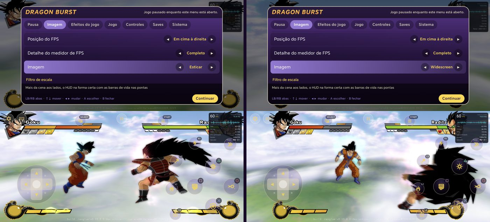<br>
  <sub>O mesmo momento, trocado no menu do jogo: Esticar (à esquerda, personagens alargadas) e Widescreen
  (à direita, mais cena e as proporções certas).</sub>
</p>

<table>
  <tr>
    <td>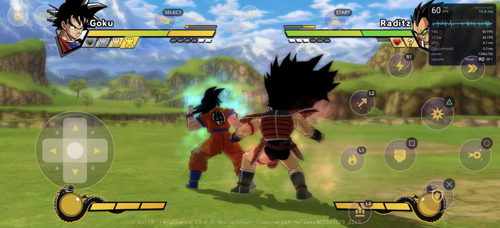</td>
    <td>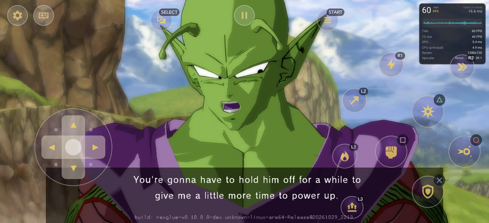</td>
  </tr>
  <tr>
    <td><sub>Campanha (Z Chronicles): 60 FPS, mínimo 59,7.</sub></td>
    <td><sub>Cutscenes em tela cheia, legendas na forma certa.</sub></td>
  </tr>
</table>

<p align="center">
  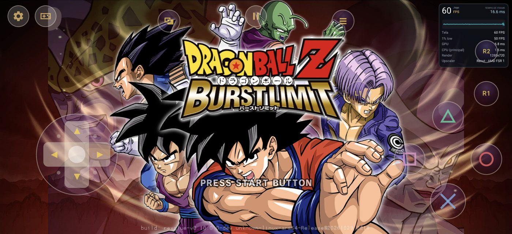<br>
  <sub>Tela de título: o fundo vai até às pontas, personagens e texto sem deformar.</sub>
</p>

## Launcher

<p align="center">
  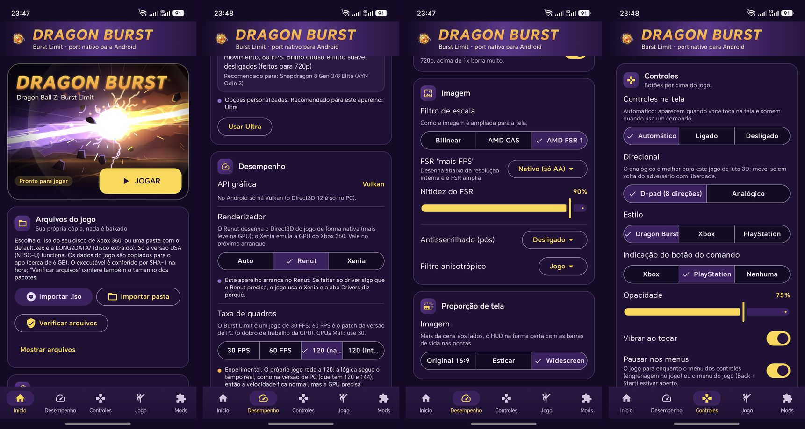<br>
  <sub>Início, Desempenho (renderizador e taxa de quadros), Proporção de tela e Controles.</sub>
</p>

<p align="center">
  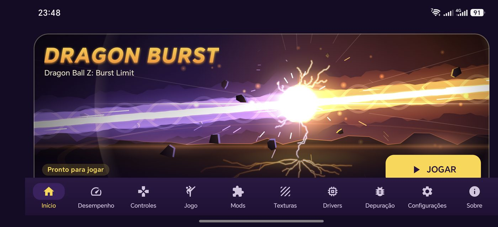<br>
  <sub>Deitado, as dez abas cabem de uma vez na barra de baixo.</sub>
</p>

- Importar o jogo direto do `.iso` ou de uma pasta extraída (`default.xex` + `LONG2DATA/`). Só a versão
  USA: o app confere o executável e avisa se o disco é de outro jogo, de outra região, alterado ou cortado.
  **Verificar arquivos** confere a instalação depois.
- O código do jogo vem cifrado no APK e só se abre com o `default.xex` do seu disco. No primeiro JOGAR o app
  prepara-o a partir do jogo importado (com barra de progresso); quem vem da 0.1.x não importa de novo.
- **Barra de abas em baixo**, de pé e deitado: Início, Desempenho, Controles, Jogo, Mods, Texturas,
  Drivers, Depuração, Configurações e Sobre. De pé a barra rola e mantém a aba escolhida à vista.
- **Ícone novo**: uma esfera laranja com uma estrela, numa aura dourada com faíscas (desenho original). Tem
  também a versão monocromática para os ícones temáticos do Android 13+.
- Tema próprio, idiomas português, inglês e espanhol, atalho na tela inicial.
- **Atualização automática**: ao abrir, o app procura uma versão nova nas Releases do GitHub, mostra o
  que mudou (no idioma do app), baixa o APK e abre o instalador.

## O que tem

**Jogo** (as opções da versão de PC que funcionam no Android)
- 30 FPS (original) ou 60 FPS, e os modos de 120 FPS (abaixo).
- Roupas do modo história, cenários extras, começar transformado (RB/LB), carregar ki (segurar L3),
  personagens extras de mods, ícones de botão Xbox/PlayStation/Switch, "Online" em vez de "Xbox LIVE",
  sons de menu, campo de visão, câmera livre e congelar o jogo (modo foto).
- Menu do jogo próprio do Android (Back + Start, ou o botão de pausa): imagem, efeitos, jogo, controles,
  save e sistema, com o jogo pausado.
- **Pausa fora da tela**: HOME, recentes ou a tela desligada param a luta, o desenho e o som; na volta o
  jogo continua de onde estava.
- **Saves**: exportar/importar pelo menu do jogo; o mesmo `.zip` da versão de PC e do Xenia. A aba Jogo
  copia os saves de e para a pasta Download. Conquistas guardadas por perfil.

**Mods e texturas**
- Mods no formato da versão de PC (`mods/`, `mod.toml`): instalar `.zip`, ligar/desligar, tipo detectado,
  aviso de conflitos e de pasta a mais.
- **Packs de texturas HD** (a substituição de texturas foi portada para o Vulkan): vários packs, um ativo,
  conferência dos nomes e formatos, pré-carregamento opcional e extração das texturas originais para
  criar packs. Como na v7.3 do PC: alfa pré-multiplicado, imagens acima de 8192 reduzidas, mips como os do
  jogo e cores certas nas texturas ARGB.

**Gráficos**
- **Renderizador**: Auto (padrão, usa sempre o Renut), Renut ou Xenia.
- **5 predefinições** (Mínimo, Leve, Equilibrado, Alto, Ultra) com os processadores recomendados para
  cada uma; o app sugere a do seu aparelho.
- Resolução interna **Tela, 480p, 540p, 720p, 1080p (só no Renut), 2K (1440p) ou 4K (2160p)**. "Tela"
  desenha na altura que a imagem ocupa na tela; nas telas pequenas o app sugere-a no primeiro arranque.
- **Proporção de tela**: Original 16:9, Esticar ou **Widescreen** (acima).
- Efeitos do jogo ligáveis (profundidade de campo, brilho, desfoque de movimento, filtro suave), AMD
  FSR 1 + CAS, FXAA, filtro anisotrópico. Nos upscales grandes (540p ou 480p numa tela 1080p) o FSR vai
  até 720p e o resto é bilinear, o que poupa quase metade da GPU por quadro.
- **Drivers Vulkan**: o do sistema ou Turnip (Mesa) via libadrenotools, baixados dos repositórios da
  comunidade ou importados. A aba Drivers mostra o nível de suporte do Turnip para o seu Snapdragon.
  **Turnip é experimental neste port** (veja os aparelhos testados).

**120 FPS** (só em telas de 120 Hz; nas outras as opções não aparecem)
- **120 (nativo)**: o próprio jogo roda a 120, como na versão de PC, à mesma velocidade de jogo. A GPU
  precisa de cada quadro em menos de 8,3 ms. No AYN Odin 3 com o Renut a 1080p: 120 estáveis na luta e
  na campanha, em 15 minutos seguidos.
- **120 (interpolado)**: o jogo roda a 60 e a GPU gera um quadro entre cada dois reais. Mais um quadro
  de latência (cerca de 8 ms); o HUD continua nítido. No Odin 3: 117 na tela com o Renut a 1080p, 120
  com o Xenia a 720p.
- Os dois continuam **experimentais**: o online não foi verificado a 120.

<p align="center">
  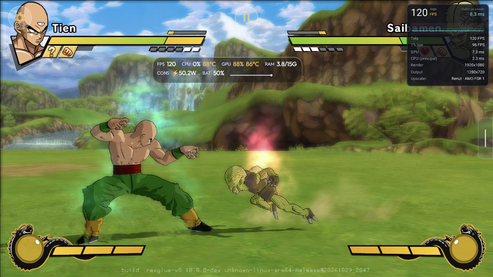<br>
  <sub>AYN Odin 3, Renut a 1080p e 120 FPS (nativo) na campanha.</sub>
</p>

**Controles**
- Controles na tela feitos para não cobrir o jogo: D-pad de 8 direções (ou analógico), botões com o
  visual do jogo, transparentes, que aparecem quando você toca e somem quando usa um controle.
- Layouts separados para luta, menus e câmera livre (trocado sozinho), editor de layout e macros
  (combinação ou sequência), botões do port (Ki, Aura Spark, Transformar, Arremesso, Perseguição, menu).
- Controles físicos com zona morta e vibração. O jogo lê o comando no momento em que pergunta por ele
  (menos atraso), o login funciona com o comando em qualquer jogador (2-4), e os comandos sem mapeamento
  no SDL usam um mapeamento genérico.

**Online**
- **Rede local (Wi-Fi)**, o método LAN da versão de PC: um aparelho é o anfitrião, o outro digita o IP.
  **Experimental**: ainda não testado entre dois aparelhos. Os dois precisam do mesmo APK.
- O lobby pela internet (Ranked, placares) ainda não está no Android, e não há cross-play com o PC.

**Diagnóstico**
- Se o jogo fechar com o Renut, o app avisa e oferece **Exportar logs**; só a partir do 2.º fecho seguido
  pergunta se quer usar o Xenia por agora. Nunca troca sozinho.
- **Autoteste do render** (menu do jogo → Sistema, cerca de 1,5 min, numa luta offline): desliga cada
  atalho do renderizador Xenia, compara as imagens e diz qual estraga a imagem e quanto cada um vale.
- **Exportar logs** (aba Sobre, aba Depuração ou menu do jogo → Sistema): um `.zip` em Download com os
  logs, o resultado do autoteste e a última captura de quadros.

Lista completa, recurso por recurso, contra a versão de PC: [docs/COMPATIBILIDADE.md](docs/COMPATIBILIDADE.md).

## Desempenho

**Renut (0.2.0, padrão).** O renderizador nativo do
[Zandatsu](https://github.com/dfdx047/Zandatsu): desenha o Direct3D do jogo direto em Vulkan, sem imitar a
GPU do Xbox 360. O Auto usa-o sempre, em todas as GPUs. Para o Burst Limit ele ganhou, entre outras
coisas: o toon das personagens com as cores certas (cabelo e roupas), as partículas e o Now Loading sem
quadrados, o widescreen, o ritmo de 120 FPS, o layout de descritores que cada driver aceita (o do Honor
Magic 7 Pro fechava ao arrancar) e uma thread de interface que já não ocupa um núcleo inteiro (no Odin 3 a
CPU desceu de 103 °C para 82 °C de média).

<table>
  <tr>
    <td>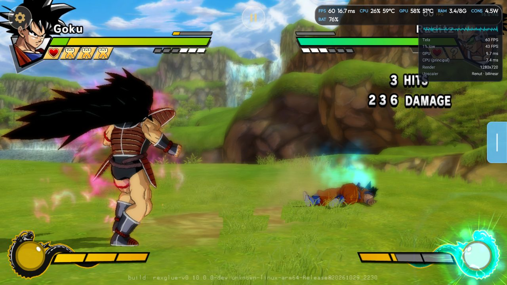</td>
    <td>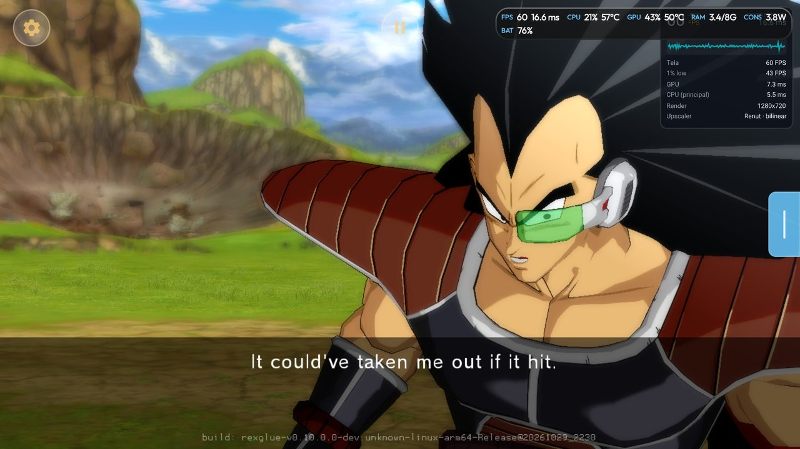</td>
    <td width="24%">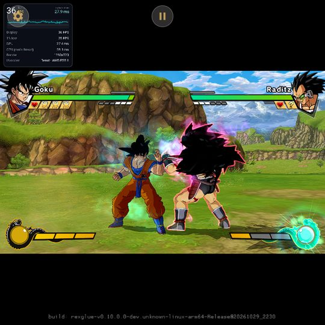</td>
  </tr>
  <tr>
    <td><sub>Retroid Pocket 5, Renut a 720p: 60 FPS na luta.</sub></td>
    <td><sub>Retroid Pocket 5, campanha: 60 FPS.</sub></td>
    <td><sub>RG Cube (tela 1:1), Renut.</sub></td>
  </tr>
</table>

**Xenia.** O renderizador do Burst Limit Recompiled imita a GPU do Xbox 360 e é pesado para um celular.
O Dragon Burst troca as partes mais caras por um **render nativo**, passo a passo, cada um com interruptor
e validado pelo autoteste:

1. a imagem final apresentada direto, sem a última cópia de tela inteira;
2. a profundidade linear calculada por compute, direto do depth buffer;
3. o pós-processamento enxuto (draws vazios e resolves repetidos ou sem leitor saltados) e o contorno, a
   redução, o desfoque e a composição do brilho feitos por compute;
4. os passes do pós-processamento desenhando direto na textura de destino.

Mais as otimizações de GPU do Dragon Fury e três otimizações para Mali (cópia direta para a textura,
resolves servidos pelo passo 4, escritas sem leitor). No Retroid Pocket 5, a 720p com todos os efeitos, a
luta foi de 12-16 FPS para até 60 FPS. O método e as ferramentas estão no
**[OptXbox](https://github.com/dfdx047/Optxbox)**; o histórico com os números de cada rodada, em
[docs/ESTADO.md](docs/ESTADO.md) e [docs/renut/PROGRESSO.md](docs/renut/PROGRESSO.md).

## Aparelhos testados

| Aparelho | Processador / GPU | Driver | Resultado |
|---|---|---|---|
| Retroid Pocket 5 | Snapdragon 865 / Adreno 650 | do sistema (Qualcomm) | Renut a 720p: 60 FPS estáveis na luta e na campanha (GPU 8-11 ms). Xenia a 720p com todos os efeitos: até 60 FPS na luta, cerca de 47-50 FPS nas cenas pesadas. |
| Retroid Pocket 5, perfil 480+ | Snapdragon 865 / Adreno 650 (GPU limitada) | do sistema / Turnip | Renut com FSR: 60 FPS a 480p e a 540p na luta e na campanha (mínimo 59 a 540p). |
| Retroid Pocket 5 | Snapdragon 865 / Adreno 650 | Turnip (Mesa 25.3 e 26.3) | Imagem errada (fundo cor de azeitona, cores trocadas). Use o driver do sistema. |
| Anbernic RG Cube | Unisoc T770 / Mali-G57 MC4 | do sistema | Renut com "Tela" (360p): 60 FPS na luta e na campanha; 480p 59 FPS; 540p 49 FPS na luta e 55 na campanha (limitado pela GPU). Xenia a 720p com efeitos: 22-24 FPS. |
| AYN Odin 3 | Snapdragon 8 Elite / Adreno 830, tela 120 Hz | do sistema | Renut a 1080p: 60 e 120 FPS (nativo) na luta e na campanha, 120 estáveis em 15 minutos. 120 interpolado: 117 na tela (Renut 1080p), 120 (Xenia 720p). |
| Honor Magic 7 Pro | Snapdragon 8 Elite / Adreno 830, tela 2800x1280 | do sistema | Renut a 720p em widescreen (2,19:1): 60 FPS na luta (GPU 9-10 ms) e na campanha (mínimo 59,7). |

## Hardware

- **Entrada:** classe Unisoc T770 / Mali-G57 MC4 com o Renut: 60 FPS com a resolução "Tela" numa tela
  pequena (RG Cube, 360p) ou a 480p.
- **60 FPS a 720p:** Snapdragon 865 (Adreno 650) com o Renut e o driver do sistema.
- **Recomendado:** Snapdragon 8 Gen 2 ou mais novo (ex.: AYN Odin 3), que dá 1080p e os 120 FPS (com uma
  tela de 120 Hz).
- **Não testado:** qualquer coisa abaixo de um Mali-G57 MC4 ou de um Adreno 6xx intermediário. A
  predefinição Mínimo (480p) existe para esses aparelhos, mas não foi medida.
- **CPUs ARMv8.0** (Snapdragon 660/665, Exynos 9611 e outros só com Cortex-A73/A53): desde a 0.2.2 o APK traz
  um conjunto próprio para eles, escolhido sozinho pelo CPU. Arranca no Mi A3 (Snapdragon 665); desempenho não medido.
- Sempre: Android 11 ou mais novo, arm64, Vulkan e cerca de 6 GB livres para os dados do jogo.

## Problemas conhecidos

- Só a versão **USA (NTSC-U)** do jogo.
- **Widescreen só com o Renut.** Com o Xenia a imagem fica em 16:9 (o HUD não é reposicionado no Vulkan).
- Em widescreen o Renut desenha 1280 colunas e estica-as até à largura da tela: a imagem fica um pouco
  mais suave na horizontal do que em 16:9.
- Em widescreen o **menu principal** fica com faixas escuras aos lados (as peças dele não cobrem a tela;
  é igual na versão de PC). O título, o Versus e a escolha de palco vão até às pontas.
- **AYN Odin 3:** os números acima são de antes da correção do Honor Magic 7 Pro (que mudou o layout de
  descritores nos drivers da Qualcomm); falta medir de novo.
- **Turnip no Adreno 650** (Retroid Pocket 5) deixa a imagem errada: use o driver do sistema.
- **Xenia:** na tela de título o Start pode precisar de vários toques (o Renut responde ao primeiro).
- **Xenia acima de 720p** (2K, 4K): o render nativo desliga. O 1080p é só do Renut.
- **120 FPS:** experimentais; o online não foi verificado a 120.
- **Online:** só rede local, experimental e ainda não testada entre dois aparelhos; sem lobby pela
  internet (Ranked, placares) e sem cross-play com o PC.
- Packs de texturas e mods ainda não foram testados com packs grandes nos aparelhos.

## Instalar

1. Baixe o APK em [Releases](https://github.com/dfdx047/Dragon-Burst/releases) e instale (o Android pede
   para permitir a instalação de apps desconhecidos).
2. Abra o Dragon Burst e toque em **Importar .iso** (o `.iso` do seu disco) ou **Importar pasta**. Só a
   versão USA (NTSC-U) funciona.
3. Escolha uma predefinição na aba Desempenho (o app sugere a do seu aparelho); numa tela mais larga que
   16:9 ligue o **Widescreen** em Proporção de tela. Toque em **JOGAR**.

As próximas versões chegam pelo próprio app.

## Aviso legal

Nenhum arquivo do jogo vem incluído e nada é baixado: o app só usa a cópia que você importa. Faça o dump
do seu próprio disco; não peça nem compartilhe ISOs. Projeto de fã, não oficial e sem fins comerciais.
Dragon Ball pertence a Bird Studio/Shueisha, Toei Animation e Bandai Namco. O ícone e o banner são
desenhos originais do projeto.

## Compilar

O código do jogo é gerado a partir do seu próprio `default.xex` USA, por isso o build precisa da sua
cópia. Precisa do NDK 28.2.13676358, JDK 17, clang 20+, cmake e ninja. Passo a passo em
[docs/ESTADO.md](docs/ESTADO.md#como-compilar-pc-linux). Resumo:

```bash
bash tools/setup-external.sh
bash tools/apply-patches.sh
bash tools/apply-renut-patches.sh
bash tools/codegen.sh /path/to/BurstLimit.iso   # or default.xex
./gradlew assembleRelease
```

`bash tools/install.sh` instala nos aparelhos ligados por adb. Os patches do SDK e do jogo estão em
`patches/`, os do Renut em `patches/renut/`. O ícone é gerado por `tools/icon_gen.py`.

## Reportar problemas

1. Numa luta offline, abra o menu do jogo → Sistema → **Autoteste do render** e espere terminar.
2. Toque em **Exportar logs** (no mesmo menu ou na aba Sobre): o arquivo `DragonBurst-logs-*.zip` vai
   para a pasta Download.
3. Abra uma issue no GitHub com o aparelho, a predefinição/opções usadas (renderizador, resolução,
   proporção de tela), o que aconteceu e o `.zip`.

## Créditos

- iExplosiveRage: [DBZ Burst Limit Recompiled](https://github.com/iExplosiveRage/DBZ-Burst-Limit-Recompiled),
  incluindo o widescreen da v7.3.
- Equipe do ReXGlue SDK e o projeto [Xenia](https://github.com/xenia-project/xenia), de onde vem o
  renderizador Xenia.
- [Zandatsu](https://github.com/dfdx047/Zandatsu), de onde vem o Renut.
- NovaPowers (DBZ Budokai 3 HD), de cujo port Android, o Dragon Fury, este parte.
- SDL, libadrenotools (bylaws) e quem compila os drivers Turnip/Mesa (Mr. Purple, StevenMXZ, K11MCH1).

Desenvolvido por dfdx047 · [Discord](https://discord.gg/nXSANX9V6k) · [YouTube](https://www.youtube.com/@DFDX47) ·
[Ko-fi](https://ko-fi.com/dfdx047)
